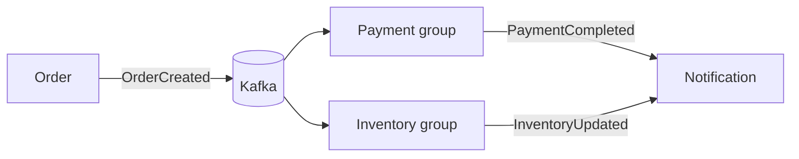

# ADR-0001: Parallel payment and inventory learning branches

- **Status:** Accepted
- **Date:** 2026-11-24
- **Related tasks:** P0-006; interpretation of P4-019 and P4-020
- **Decision makers:** Project owner, approving the parallel-flow recommendation in chat on 2026-11-24.

## Context

The master and architecture diagrams show Payment and Inventory independently consuming OrderCreated. The P4 task titles for consuming PaymentCompleted and then triggering Inventory imply a sequential dependency. Both readings cannot govern the same normal flow. The task workflow required recording the conflict and obtaining direction before completion. The owner selected the recommended parallel flow.

## Decision

Payment and Inventory use distinct consumer groups to consume OrderCreated independently. They publish PaymentCompleted and InventoryUpdated respectively on successful simulated outcomes. Notification observes individual outcomes and records synthetic notifications; it does not infer atomic global order completion.

This dated clarification governs implementation interpretation. Preserve the original roadmap/task titles and stable IDs. P4-019 remains a payment-completion consumption exercise; P4-020's Inventory operation must be triggered by OrderCreated, not gated on PaymentCompleted. Its existing CSV prerequisite order remains the learning sequence, not the runtime dependency. When executing those tasks, cite this ADR and verify the parallel trigger explicitly.

## Rationale and alternatives

| Option | Advantages | Disadvantages | Why selected/rejected |
|---|---|---|---|
| Parallel branches | Matches the master diagrams and independent-subscription objectives; exposes partial outcomes and fault isolation | Can reserve fake stock even when fake payment fails; later consistency/compensation must explain this | Selected by owner for teaching value |
| Sequential Order -> Payment -> Inventory | Fewer independent outcomes and aligns with a literal reading of the P4 task titles | Couples Inventory availability to Payment, changes the agreed overview and learner experiments | Rejected for this baseline |

## Consequences

No cross-service atomicity, delivery guarantee, or completed business workflow follows from this topology. A stopped/rejected payment branch must not prevent Inventory from observing OrderCreated. Repeated deliveries and side effects require separate reliability experiments; compensation remains P8 work. All effects stay synthetic, with independent data ownership and no new external trust boundary. There is no deployed system or new broker configuration.

## Validation and review

The [simulation scenarios](../../requirements/e-commerce-simulation.md) cover normal, partial failure, interruption, duplicates, and later compensation. Documentary review is in [P0-006 evidence](../../testing/evidence/P0-006-review.md); reasoning is in the [learning note](../../learning-notes/P0/P0-006.md). P4/P6/P8 must later supply runtime observations. Revisit only if a documented learning need justifies changing the dependency, with an ADR superseding this one rather than silently editing history.
