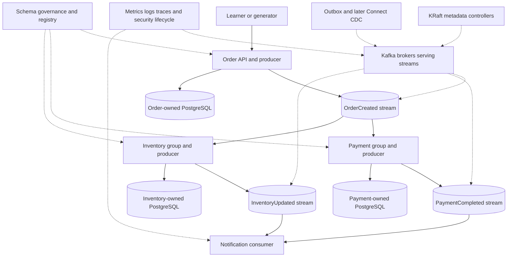

# P0-029 - Create logical component diagram

**Date:** 2026-11-24
**State:** Reviewed planning decision; no runtime implementation or measured results.

## Logical component view (target only)

Solid arrows show business interactions or exclusively owned local storage. Dotted arrows summarize metadata/support relationships rather than a claimed protocol configuration. The Outbox/CDC capability operates on each owning service's publication intent; its single diagram box is shorthand, not shared database access. Kafka topic resources are served by brokers and governed through KRaft metadata; controllers do not process payment business logic.

P3 starts smaller; services P4, replication/control-plane experiments P5, reliability/contracts P6/P7, PostgreSQL/Outbox/CDC P8, security P9, full observability P10 and advanced deployment P13 arrive later. Notification records synthetic effects without a new mandatory shared database. Registry/operator/versions remain later choices.

Review checks four application roles, independent branches, three owned stores and no cross-service SQL edge. Runtime topology, Mermaid rendering, trust enforcement and failure behavior were not executed or observed in P0.

## Evidence

See [task learning record](../learning-notes/P0/P0-029.md) and [document review](../testing/evidence/P0-029-review.md).
