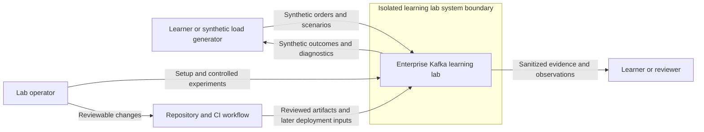

# P0-028 - Create system-context diagram

**Date:** 2026-11-24
**State:** Reviewed planning decision; no runtime implementation or measured results.

## System context (conceptual, not deployed)

The learner and operator may be the same person, but their logical responsibilities differ: scenario input versus administrative control. The reviewer examines evidence rather than assumes a successful business operation from generated code. Repository/CI tools are an administrative supply-chain interface, not a live payment or customer service.

All domain inputs and outcomes are synthetic. No real customer identity, payment processor, email/SMS provider, warehouse or public storefront crosses this boundary. The system includes the services and supporting infrastructure detailed in P0-029; they are deliberately collapsed here.

Positive review follows a synthetic order into the lab and observations back to the learner. Negative review rejects a real provider connection or production SLA inferred from this drawing. No trust boundary is asserted as enforced; P0-035/P0-036 identify security crossings and threats. Mermaid source was reviewed for nodes/edges and correspondence to the scope; no visual renderer or running-system topology discovery was executed.

## Evidence

See [task learning record](../learning-notes/P0/P0-028.md) and [document review](../testing/evidence/P0-028-review.md).
