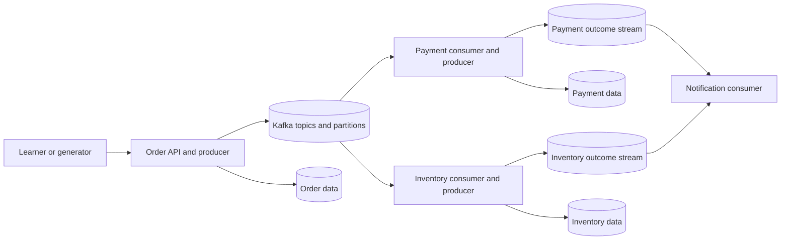

# P0-008 - Define final target architecture

**Date:** 2026-11-24
**State:** Reviewed planning decision; no runtime implementation or measured results.

## Target and invariants

This is the conceptual end-state, following ADR-0001. Order, Payment, Inventory, and Notification are independently buildable/deployable Maven Java/Spring Boot applications. Order publishes OrderCreated; Payment and Inventory consume it in distinct groups and publish their own outcomes. Notification records individual synthetic outcomes and never infers a global transaction. Each stateful business service owns its PostgreSQL data and migrations; no cross-service SQL access or shared mutable business library is permitted.

## Layers and boundaries

| Layer | Target | Constraints |
|---|---|---|
| Kafka data/control | Advanced replicated multi-broker KRaft cluster; initial one broker | Controllers govern metadata; brokers store/serve records; no deployment or RF/quorum setting here |
| Contracts | Governed schemas and later chosen registry | Validate compatibility independently of deployment; schemas do not replace semantic review |
| Data/integration | PostgreSQL, transactional Outbox, Connect/Debezium; later Saga experiment | Local transactions do not imply global atomicity; replay can duplicate effects |
| Security | TLS/mTLS, SASL/ACLs, identities and PKI/secret lifecycle | Encryption, authentication and authorization are distinct; progressive implementation |
| Operations | Logs, metrics, traces, dashboards, alerts and recovery runbooks | Evidence must connect failure to behavior; observability is not correctness proof |
| Delivery | Compose locally, supported operator/Helm Kubernetes later; CI/security gates | Versions/pins and safe rollout/rollback reviewed at owning tasks |

## Evolution and verification

P3 begins with one topic, producer, consumer and broker, learning native clients before Spring Kafka. P4 introduces independent services; P5 studies replication/KRaft; P6-P8 add correctness/contracts/persistence; P9-P12 add security, operations, measurement and recovery; P13-P14 add advanced deployment and release assurance. No technology or service is installed by this document.

Positive review traces one synthetic order to both outcomes and separate notifications. Negative review traces a stopped Payment consumer: Inventory can progress, but no global checkout success is claimed. A database outage affects that service's local transaction boundary and later publication recovery, not another service's direct SQL transaction. Hardware feasibility, exact topology, compatible versions, registry/operator choice, and runtime security guarantees remain unverified. Existing architecture/phase files are preserved; this operational target cites the accepted flow clarification rather than silently editing history.

## Evidence

See [task learning record](../learning-notes/P0/P0-008.md) and [document review](../testing/evidence/P0-008-review.md).
