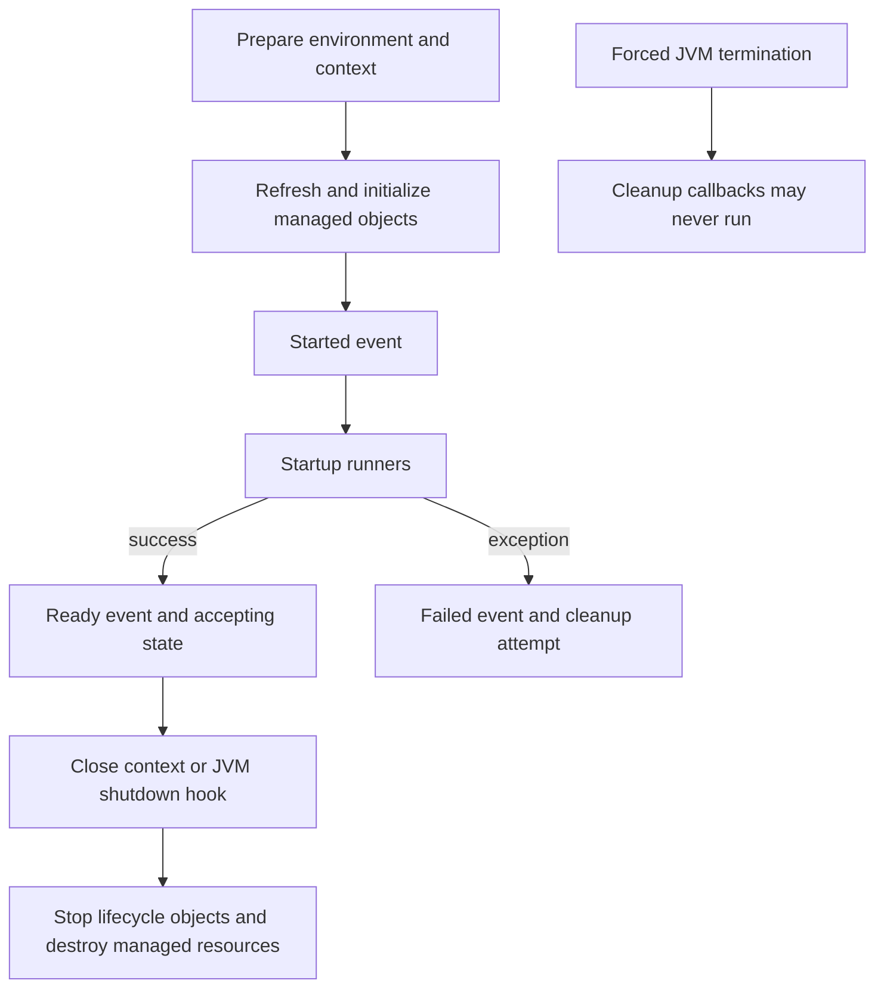

# Spring Boot application lifecycle

P2-015 studies the existing [non-web starter](../../applications/lab-starter/README.md), using Spring Boot **4.2.0**, Spring Framework **7.1.0**, Java **25.0.5.1** and Maven **3.10.2**. Develop in the Windows checkout and execute Java/Maven in Ubuntu WSL. This is a concept guide with temporary experiments, not a change to the application, its dependencies or its deployment model. [ADR-0015](../architecture/decisions/0015-minimal-spring-boot-starter.md) still applies; no new architecture decision is required.

## Three lifetimes to distinguish

The **JVM process** hosts threads and shutdown hooks. The **application context** manages Spring objects and its refresh/close transitions. An individual **bean** is constructed, initialized and, when managed appropriately, destroyed by that context. Their boundaries differ: closing a context does not forcibly terminate every thread in the JVM, and process termination can prevent any context cleanup.

The starter's main method delegates to `SpringApplication.run`. Boot selects its context from the classpath, prepares configuration and refreshes the context before running startup work. The base starter has no HTTP server or long-running consumer; normal JVM exit after successful startup is expected. It is not an unhealthy web service. Lazy/scoped objects and additional contexts would add lifetimes that this small single-context experiment does not cover. [SpringApplication API](https://docs.spring.io/spring-boot/api/java/org/springframework/boot/SpringApplication.html)

## Startup milestones

The following table describes a successful run in this lab. Events are observations, not permission to add business behavior at every stage. Early listeners must be registered before `run`; a bean listener cannot observe events sent before its context exists. Keep synchronous listeners short. [Boot events](https://docs.spring.io/spring-boot/reference/features/spring-application.html#features.spring-application.application-events-and-listeners)

| Milestone | Meaning / boundary |
|---|---|
| `ApplicationStartingEvent` | Run begins; the context does not exist yet. |
| `ApplicationEnvironmentPreparedEvent` | Environment prepared, before context creation. Never dump its properties. |
| Initializers, then `ApplicationContextInitializedEvent` | Context initialized, before application bean definitions load. |
| `ApplicationPreparedEvent` | Definitions loaded; refresh is about to begin. |
| Refresh | Managed singleton initialization and auto-start lifecycle processing; `ContextRefreshedEvent` follows successful refresh. |
| `ApplicationStartedEvent` | Refresh completed; startup runners have not run yet. This alone does not prove readiness. |
| Liveness `CORRECT`, then runners | Observed before the probe's `ApplicationRunner`. |
| `ApplicationReadyEvent`, then readiness `ACCEPTING_TRAFFIC` | Startup runners completed successfully; `run` subsequently returns. No HTTP listener is implied in this non-web application. |

The started/ready distinction is explicit in the [started event API](https://docs.spring.io/spring-boot/api/java/org/springframework/boot/context/event/ApplicationStartedEvent.html) and [ready event API](https://docs.spring.io/spring-boot/api/java/org/springframework/boot/context/event/ApplicationReadyEvent.html). A failed runner interrupts this successful path: our probe received `ApplicationFailedEvent` and exited **1**, with no ready event, accepting-traffic state or normal return. Failures earlier in bootstrap need not have a usable context at all. [Failure event API](https://docs.spring.io/spring-boot/api/java/org/springframework/boot/context/event/ApplicationFailedEvent.html)



## Choosing a callback

| Mechanism | Appropriate responsibility | Trap to avoid |
|---|---|---|
| Constructor | Establish valid local object state. | Blocking network acquisition before the container can manage cleanup. |
| `jakarta.annotation.PostConstruct` / `PreDestroy` | Bean-local initialization / release through registered annotation processing. | Treating one bean's initialization as proof that the application is ready; assuming destruction runs after every failed initialization. |
| `ApplicationRunner` | Finite startup work using parsed `ApplicationArguments`; `CommandLineRunner` uses the raw argument array. | An endless consumer loop or unbounded dependency retry prevents ready completion. |
| Application listener | Observe a milestone, using early registration when needed. | Long synchronous work or logging environment/event payloads. |
| `SmartLifecycle` | Coordinated start/stop of a managed ongoing capability when introduced later. | Forgetting the completion callback in asynchronous `stop(Runnable)`. |

Our temporary marker's constructor preceded `PostConstruct`, which preceded `SmartLifecycle.start`. Destruction used `PreDestroy` exactly once after regular stop. The annotations come from **jakarta.annotation**, not a JDK-supplied `javax.annotation` package. We add no new annotation dependency: the existing starter runtime already includes the Jakarta API. [Annotation lifecycle reference](https://docs.spring.io/spring-framework/reference/core/beans/annotation-config/postconstruct-and-predestroy-annotations.html)

Runners can be ordered through `Ordered`/`Order`; independent beans do not gain a reliable global initialization order merely from their source-file layout. There was only one runner in this probe. [ApplicationRunner API](https://docs.spring.io/spring-boot/api/java/org/springframework/boot/ApplicationRunner.html)

Plain `Lifecycle` does not automatically start on refresh. `SmartLifecycle` adds auto-start and phases: lower phases start first and higher phases stop first, subject to dependency relationships. The asynchronous stop callback signals actual completion and must be invoked after work stops. A phase budget is not a single global shutdown deadline. No real worker, phase dependency graph or asynchronous drain was implemented/tested here. [SmartLifecycle API](https://docs.spring.io/spring-framework/docs/current/javadoc-api/org/springframework/context/SmartLifecycle.html)

## Availability and shutdown are separate contracts

Liveness describes internal ability to function; readiness describes willingness to accept work. A ready state does not certify all external services or install a routing/probe mechanism. Availability state can be queried and explicitly changed through published events. Our non-web starter has neither Actuator endpoints nor a platform that acts on those states. [Availability API](https://docs.spring.io/spring-boot/api/java/org/springframework/boot/availability/ApplicationAvailability.html), [readiness API](https://docs.spring.io/spring-boot/api/java/org/springframework/boot/availability/ReadinessState.html)

For future clients, consider transient broker/database failures separately from irrecoverably broken internal state; restarting every instance because one external service fails can amplify an outage. This is a design implication, not an implemented health policy. Availability/Actuator and Kafka recovery belong to their later tasks.

In the observed **non-web** run, explicit `close()` and SIGTERM caused `ContextClosedEvent`, marker stop, then marker destruction. Neither trace contained a `REFUSING_TRAFFIC` availability event. Do not infer readiness withdrawal merely from close. The close event announces context closing; it is not evidence that all resource cleanup has finished. On failed refresh, some already-created resources may need destruction even when normal stop callbacks are not reached. [Context close event](https://docs.spring.io/spring-framework/docs/current/javadoc-api/org/springframework/context/event/ContextClosedEvent.html), [container lifecycle](https://docs.spring.io/spring-framework/reference/core/beans/factory-nature.html)

The temporary hold mode deliberately waits on the main thread so the JVM survives long enough to receive a signal. SIGTERM produced exit **143** and cleanup; a separately owned JVM receiving SIGKILL produced Python return code **-9** with no close/stop/destroy markers. This is an observed Linux result, not a portable exit-code promise. The normal starter requires no such hold. JVM hooks can run during orderly shutdown but cannot guarantee cleanup after forced termination; hooks must finish and must not wait indefinitely on each other. [JDK shutdown sequence](https://docs.oracle.com/en/java/javase/25/docs/api/java.base/java/lang/Runtime.html)

Boot's embedded-web graceful-shutdown contract concerns server request draining during context closure. It does not establish Kafka offset safety, producer flush completion or a whole-process deadline, and this lab has no embedded server. Future container grace periods must account for every shutdown phase and any final forced termination. No shutdown timeout or server property is changed by this task. [Web graceful shutdown](https://docs.spring.io/spring-boot/reference/web/graceful-shutdown.html)

## Kafka and enterprise engineering implications

These are future design checks, not installed capabilities:

- Keep required startup validation finite; announce readiness only when the capability is actually usable. Avoid interpreting a started-event/log line as ready.
- On shutdown, stop accepting new work, bound in-flight processing, and close owned clients/executors in a deliberate order. Readiness withdrawal and consumer intake control are distinct operations.
- Never rely on destruction callbacks as the only durability mechanism. A process can disappear between processing and committing; broker delivery semantics, replay and idempotency still matter.
- Keep secrets and raw records out of lifecycle diagnostics. Prefer fixed event names, safe aggregate status and locally controlled failure fixtures.
- Release partially acquired resources safely when startup fails. Normal close behavior does not prove every failure path is safe.

## Executed checks and reproduction

The [P2-015 evidence](../testing/evidence/P2-015-review.md) contains the complete temporary Python/Java driver and actual allowlisted traces. Inside WSL, build the unchanged starter from repository root:

```bash
bash scripts/wsl/lab.sh sh mvnw -f applications/lab-starter/pom.xml clean verify
```

Copy the evidence's **Lifecycle experiment** Python block to a temporary file, inspect it, then run `bash scripts/wsl/lab.sh python3 /tmp/p215-lifecycle-probe.py`. It resolves the existing runtime classpath through the pinned dependency plugin, compiles only in a Linux temporary directory, uses 96MiB heap caps and bounded waits, and terminates only processes it created. It leaves the application, POM and CI untouched. No additional dependencies need installation; uncached Maven artifacts require normal HTTPS access.

| Experiment | Actual result |
|---|---|
| Unchanged application clean verify | One smoke test; zero failures/errors/skips; build passed. |
| Normal temporary probe | Exit0; ordered startup, readiness, explicit close/stop/destruction; context inactive. |
| Runner failure | Exit1 after started event; failed event and cleanup; no readiness or run-return marker. |
| SIGTERM after holding marker | Exit143; close/stop/destruction observed exactly once. |
| SIGKILL after holding marker | Return-9; no cleanup markers observed. |

These are source-reviewed synthetic observations for one context and one marker, not performance, message safety, web draining or production-readiness certification. CI continues to test the unchanged application/tooling; it does not automatically replay these documentation probes. Local WSL remains UID0, existing formatter warnings remain, and vulnerability scanning is still P2-032. Roll back this task by reverting its documents/tracking update; there is no runtime configuration or persistent state to restore. Do not delete shared Maven caches or signal unrelated Java processes.

See the [task learning record](../learning-notes/P2/P2-015.md) for decisions, alternatives, risks and knowledge checks. The next task is **P2-016 — Implement dependency injection**; it is not performed by this guide.
