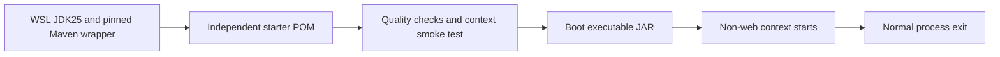

# P2-014 — Create Spring Boot application

> **Status:** Done
> **Phase:** P2
> **Dependencies checked:** P2-013: Done; preceding task committed/pushed and upstream tip matches
> **Related deliverable:** Independent non-web Spring Boot starter, executable JAR and WSL verification
> **Date completed:** 2026-11-25

## 1. Goal and context

Create the first real Spring Boot application after P2-013's Java/logging review. Learn how an annotated entry point, dependency-managed starter and executable packaging form a runnable application, while retaining an independent monorepo build. This is the future learning substrate for Java/Kafka client work, not an Order service or Spring Kafka integration. Lifecycle callbacks, injected business beans, properties/profiles, REST, Actuator, dedicated testing lessons and containerization remain their assigned tasks. The CSV deliverable is a shared phase goal; this task satisfies the minimal application acceptance, not the full P2 gate.

## 2. Concepts explained in my own words

`SpringApplication.run` creates and refreshes a Spring context. `@SpringBootApplication` combines configuration, auto-configuration and component discovery; placing it in our named package bounds application scanning. Dependency availability influences auto-configuration: the base starter supplies Boot, context and logging but no embedded web server. Consequently this application starts, emits its startup marker and naturally exits; it has no long-lived worker. This does not prove a consumer's lifecycle or delivery guarantees.

A BOM chooses compatible dependency versions; it neither adds a starter nor configures executable packaging. Our custom parent already imports Boot4.2.0. The child explicitly adds the starter and Boot plugin/repackage execution. The resulting executable JAR has a loader main class, our Start-Class, BOOT-INF/classes and nested runtime libraries. Test-scoped JUnit is available for verification without shipping in that runtime. The root tooling reactor and selected application are separate build targets that share build conventions, not business state.

## 3. Work performed and artifact

- `applications/lab-starter`: independent POM, one annotated main class, one real-context smoke test and WSL run/recovery guide.
- `.mvn/wrapper`, `mvnw`, `mvnw.cmd`: upstream script-only Wrapper3.3.4, pinned Maven3.10.2 ZIP/hash. Linux execution only; generated Windows companion is not tested or recommended.
- `.gitattributes`: explicit LF Java and POSIX wrapper, CRLF Windows companion. This fixes the observed Windows checkout/WSL formatter boundary without changing existing tooling source content.
- `scripts/ci/verify-starter.py`: report guard, manifest/bytecode/dependency checks, bounded positive and invalid-option JAR launch. The existing artifact preparer accepts an optional target for sanitized starter reports.
- CI workflow: explicit application build/CLI step, changed-path coverage and sanitized application artifact path. Existing tooling regression remains required.
- ADR-0015, README, CI guide and learning index explain actual current state. CSV and this note/evidence track only P2-014.

Run commands from repository root through `bash scripts/wsl/lab.sh`; use `sh mvnw -f applications/lab-starter/pom.xml clean verify`, then `python3 scripts/ci/verify-starter.py` through that launcher. No broker, DB or Docker dependency is needed.

## 4. Decisions and rationale

| Decision | Rationale | Alternatives and consequence |
|---|---|---|
| Non-web base starter | Smallest real Boot application; no premature network listener | Web MVC would add server/REST concepts for P2-019. |
| Own POM, relative local parent, outside reactor | Independent selection/packaging; no prior parent install needed | Root aggregation convenient but obscures the explicit boundary; copied standalone conventions would drift. |
| Existing BOM plus explicit plugin4.2.0/repackage | Preserve reviewed quality rules and make packaging visible | Boot starter parent offers sensible defaults but would replace existing parent inheritance. |
| One JUnit context smoke test plus packaged CLI | Validate real context and executable entry point without broad testing scaffolds | A generated `contextLoads` without assertions or compile-only success misses scope/packaging failures. |
| Script-only pinned wrapper | Completes ADR-0013's bootstrap deferral with no wrapper binary | Existing installer alone works but does not select Maven through source-controlled wrapper properties. |
| LF attribute for Java | Actual Windows checkout caused formatter regression | Ad-hoc format-only repair would recur on checkout. |

[ADR-0015](../../architecture/decisions/0015-minimal-spring-boot-starter.md) records this architecture/build choice, compatibility review, alternatives and cache trust limit.

## 5. Best practices and design patterns

Apply convention over configuration for a deliberately narrow classpath; isolate the composition root in the application's top package. This is framework bootstrap and IoC infrastructure, not an implemented domain dependency-inversion lesson, outbox, saga or publish/subscribe pattern. Keep test dependencies scoped and activate managed plugins explicitly. Bound child-process startup checks to30 seconds, capture diagnostics locally and print static summaries so CI artifacts avoid runtime/environment leakage. Build selection stays independent, quality failures propagate, and missing/skipped tests fail instead of producing a false green. Preserve HTTPS/checksum validation, exact pins and Linux-only tool execution. A wrapper hash protects acquisition, not a compromised writable cache or future transitive CVEs. Progressive controls remain explicit rather than claimed complete.

## 6. Common mistakes, errors and vulnerabilities

| Risk / failure | Trigger | Mitigation and observation | Residual risk |
|---|---|---|---|
| Windows line-ending drift | Java checkout became CRLF | Observed Spotless failure; LF attribute and normalization restored passing build | Existing clones may need normalization; no gate weakened. |
| Non-executable/plain JAR | Missing repackage or launching `.original` | Manifest/layout and real `java -jar` checked | Future plugin changes require rerun. |
| Incorrect Boot setting | `--spring.main.banner-mode=invalid` | Observed nonzero exit and startup failure diagnostic | No general typed application config exists yet (P2-031). |
| Corrupted download | Wrong wrapper SHA256 in temporary fresh-cache fixture | Observed refusal before extraction/execution | Upstream trusts existing cache; hashes from publisher are not independent authenticity verification. |
| Empty/failed/skipped tests | Missing or altered JUnit report | Four negative guard probes rejected | Report/schema evolution needs reviewed updates. |
| Dependency/network expansion | Adding web, Kafka or JDBC prematurely | JAR check rejects selected test/web/client libraries; actual context deduces NONE | Library-name guard is a scoped regression check, not a general network sandbox or SCA. |
| Secret disclosure / privileged execution | Logs/CI reports/environment inheritance | No credentials/config added; artifact XML excludes properties/output; Linux UID0 honestly recorded | Console output and cache remain trusted; least-privilege local account not configured. |

No data-loss, duplication, ordering or offset experiment applies because no messaging or persistent state exists.

## 7. Testing, verification and evidence

| Executed check | Observed result | Outcome |
|---|---|---|
| Independent WSL clean verify | Enforcer/format/style/compile/package passed;1 context smoke test,0 failure/error/skip | Pass |
| Packaged JAR and CLI | Boot4.2.0, Java major69, correct manifest, no selected forbidden/test libraries; starts and exits normally within30s | Pass |
| Invalid startup option | Nonzero exit with startup failure and invalid value diagnostic | Pass |
| Wrapper version/checksum | Maven3.10.2 on Linux JDK25; wrong SHA256 fresh-cache probe rejected | Pass |
| Report guards and artifact inspection | Missing/zero/failing/skipped suites rejected; sanitized XML contains status/identity only | Pass |
| Existing tooling regression | Initially failed CRLF; after LF fix,1 unit and1 integration test with no failures/errors/skips | Pass after correction |
| Resolved dependency tree | Boot4.2.0, Spring7.1.0, Logback1.6.6, SLF4J2.0.20; JUnit6.1.3 test | Reviewed |
| Hosted CI | Pending publication at the time of this record; final PR/run state reported separately | Not yet claimed |

[Evidence](../../testing/evidence/P2-014-review.md) preserves exact commands, negative probe body, actual abbreviated output, self-review and final portable integrity/CLI check. Runtime evidence is WSL execution, not invented generated-code assurance. No SCA, web integration, Kafka, database or container test ran because those capabilities are outside P2-014.

## 8. Debugging and operational notes

Successful packaged startup exits; do not diagnose that as a crashed HTTP service. The smoke-test log calls its process ForkedBooter, while packaged verification requires our actual application startup marker. Missing parent/settings/Checkstyle paths usually mean the command bypassed the root-working-directory launcher. A missing main manifest suggests wrong JAR or missing repackage. Invalid banner configuration demonstrated clear fail-fast behavior without a custom exception handler.

The control-host verification harness also needed forward-slash path input and UTF-8 bytes sent to bash stdin: Windows text-mode piping introduced CRLF and made `set -euo pipefail` fail before any application command. The corrected portable gate below passed. The application build itself was not failing. The real tooling regression was CRLF after Windows Git checkout, not Java source logic or incompatible plugins. Check `git ls-files --eol`; use the LF attribute and reviewed normalization. Existing tooling files remain content-identical. Preserve Spotless's visible Unsafe warning for future tool updates.

Rollback: ordinary revert of this task's application, wrapper, CI/docs/tracker after checking later dependencies; no schema or persistent data migration exists. Do not delete shared Linux caches or force-rewrite published history. Wrapper caches are external to Git and remain unless deliberately inspected/removed separately.

## 9. Security and SSDLC check

Assets are source/build integrity, local/CI host and future application configuration. Trust boundaries are Windows Git/editing to WSL execution, Central to build cache, source to CI runner, and raw reports to retained artifacts. No external application listener, credentials, user data, private keys or production configuration is introduced. Starter tests verify non-web deduction and actual packaged runtime libraries; this is a deliberately limited exposure boundary.

Use existing pinned JDK/Maven/Boot and HTTPS Central strict checksums. The wrapper ZIP was compared against publisher SHA512, then SHA256 pinned and its failure path exercised. Generated scripts are upstream code under their Apache header; downloads/caches and dependency resolution still require trust. No claim of signatures, SCA/SBOM, CVE absence, DLP, non-root WSL or secure deployment. P2-032 owns initial dependency scanning; image hardening/container verification and P9/P14 controls are later work. CI retains read-only token/full action pins and sanitized seven-day artifacts. Private vulnerability reporting remains a prior known limitation. Self-review found no blocking task-scoped security finding.

## 10. Lessons learned and knowledge checks

1. A runnable Spring Boot application does not require HTTP, Kafka or a database; a non-web context may finish normally.
2. BOM management and plugin execution are different: repackage must be activated under a custom parent.
3. An independent build can share a local parent without joining its aggregator or requiring a locally installed parent artifact.
4. Real packaged startup catches problems a context-only test misses; invalid options and empty reports must visibly fail.
5. Windows checkout policies affect Linux verification. Pin source line endings and understand that a wrapper verifies new acquisitions but trusts a populated cache.

Knowledge checks: Why can `mvn clean verify` at root pass without testing this application? Why must JUnit not appear in BOOT-INF/lib? Why does this process exit? What does a checksum fail to prove? Remaining study is startup/shutdown lifecycle sequencing in P2-015, then DI/configuration/REST; no lifecycle experiment is completed here.

## 11. Completion decision and handoff

Acceptance is met by an actual independent executable Boot application, passing WSL context/package/startup/negative checks, reviewed configuration/rollback, and preserved evidence. P2-014 alone is marked Done with completion date2026-11-25 and its evidence link;726 IDs/order/dependencies and15 phases are preserved. ADR-0015 and current-state/build docs are updated. Hosted run results will be reported after publication; local runtime acceptance is already demonstrated. Authorized Conventional Commit: `feat(starter): create minimal Spring Boot application`, footer `Refs: P2-014`, on `feat/P2-014-spring-boot-application`; commit/push and remote-tip comparison follow the final gate. No merge or dependent task is authorized by this completion. Next suggested task: **P2-015 — Understand application lifecycle**, not started.

## References

- [Exact task CSV](../../roadmap/Kafka_Learning_Lab_Task_Checklist.csv) and [P2 roadmap](../../roadmap/phases/P2_java-and-spring-boot-foundations.md).
- [Executed review](../../testing/evidence/P2-014-review.md).
- [Bootstrap decision](../../architecture/decisions/0015-minimal-spring-boot-starter.md) (reviewed 2026-11-25).
- [Previous Java/logging review](P2-013.md) (reviewed 2026-11-25).
- [Boot system requirements](https://docs.spring.io/spring-boot/system-requirements.html) (reviewed 2026-11-25).
- [Executable packaging](https://docs.spring.io/spring-boot/maven-plugin/packaging.html) (reviewed 2026-11-25).
- [Boot custom-parent use](https://docs.spring.io/spring-boot/maven-plugin/using.html) (reviewed 2026-11-25).
- [Root package placement](https://docs.spring.io/spring-boot/reference/using/structuring-your-code.html) (reviewed 2026-11-25).
- [Wrapper plugin](https://maven.apache.org/tools/wrapper/maven-wrapper-plugin/wrapper-mojo.html) (reviewed 2026-11-25).
