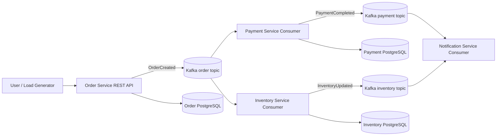
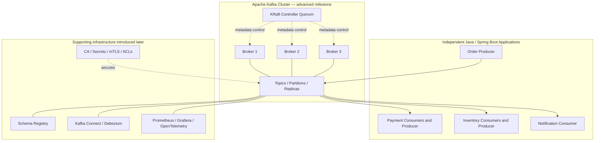
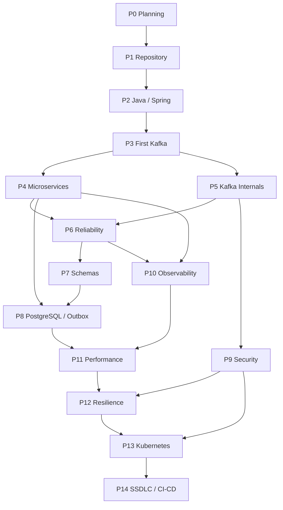

# System and Repository Architecture

> Source: Enterprise Kafka Learning Lab master roadmap (23 November 2026). Diagrams below are **conceptual planning diagrams**, not claims that any system is already deployed.

## Architecture principles

- Keep business logic minimal to focus on Kafka internals and engineering practices.
- Producer and consumer are application capabilities, not automatically microservices.
- Topics, partitions, consumer groups and dead-letter topics are Kafka resources.
- Evolve from one broker and one message to independently deployable services and a multi-broker KRaft cluster.
- Design trust boundaries early; implement controls progressively.
- Avoid sharing business-specific libraries across service boundaries.

## Logical end-to-end event flow




## Event and infrastructure topology




In the initial milestone, only a single Kafka broker, one simple application, one producer, one consumer and one topic are required. The remaining components are learning targets introduced later.

## Architecture layers

| Layer | Components |
|---|---|
| Business services | Order, Payment, Inventory, Notification, event generator |
| Kafka data plane | Brokers, producers, consumers, partitions, replicas, consumer groups, topics, DLT |
| Kafka control plane | KRaft metadata and controllers, AdminClient |
| Data and integration | PostgreSQL, Flyway, transactional Outbox, Kafka Connect, Debezium |
| Security | CA, certificate issuance and rotation, mTLS, SASL, ACLs, application identity, secrets |
| Observability | Actuator, JMX exporter, Prometheus, Grafana, tracing and log aggregation |
| Delivery | Compose, Kubernetes, Helm, CI/CD, quality and security gates |

## Repository blueprint

```text
enterprise-kafka-learning-lab/
├── README.md
├── docs/
│   ├── requirements/
│   ├── architecture/
│   │   └── decisions/
│   ├── kafka/
│   ├── security/
│   ├── operations/
│   ├── testing/
│   └── learning-notes/
├── applications/
│   ├── order-service/
│   ├── payment-service/
│   ├── inventory-service/
│   ├── notification-service/
│   ├── event-generator/
│   └── event-monitor/
├── shared/
│   ├── event-contracts/
│   ├── common-test-utils/
│   └── observability-starter/
├── infrastructure/
│   ├── docker/
│   ├── compose/
│   ├── kafka/
│   ├── postgres/
│   ├── schema-registry/
│   ├── kafka-connect/
│   ├── security/
│   ├── observability/
│   ├── kubernetes/
│   ├── helm/
│   └── terraform/
├── testing/
├── scripts/
├── .github/workflows/
└── tools/
```


Create directories as they become useful. Prefer independently built Maven applications. Secrets and private keys must not be version controlled.

## Technology decisions recorded in source roadmap

| Decision | Selected approach |
|---|---|
| Codebase | Monorepo, independent Maven modules and independently deployable services |
| Applications | Java and Spring Boot; minimal order/payment/inventory/notification simulation |
| Kafka | Apache Kafka in KRaft mode; native Java client first, Spring Kafka second |
| Persistence | PostgreSQL, later Outbox/CDC and Saga experiments |
| Deployment | Docker Compose first, Kubernetes with maintained operator later |
| Security | Progressive SSDLC: TLS, mTLS, SASL/SCRAM, Kafka ACLs, PKI and secret management |
| Quality | JUnit, Mockito, Testcontainers, security scans and contract testing |
| Operations | Prometheus, Grafana, OpenTelemetry, centralized logs and failure injection |
| Workload | Model up to 100,000 users; quantify concurrency, events/s, payloads, retention and SLOs |
| Delivery | Task-sized work, repeatable verification, ADRs, CI/CD and evidence capture |

## Security boundaries to experiment with

- Java application ↔ Kafka broker: TLS, mTLS, SASL and Kafka ACLs as separate learning exercises.
- Broker ↔ broker, KRaft controller ↔ broker: protected Kafka communications.
- Service ↔ service over HTTP: mTLS and, when required, application-level authorization.
- Service ↔ PostgreSQL: TLS, database roles and independent service ownership.
- Developer/CI ↔ infrastructure: limited administrative privileges and managed secrets.

## Architecture evolution and work dependencies




The graph indicates learning prerequisites. It is not a strict prohibition on adding early unit tests, logging, secure defaults or repository scanning.
