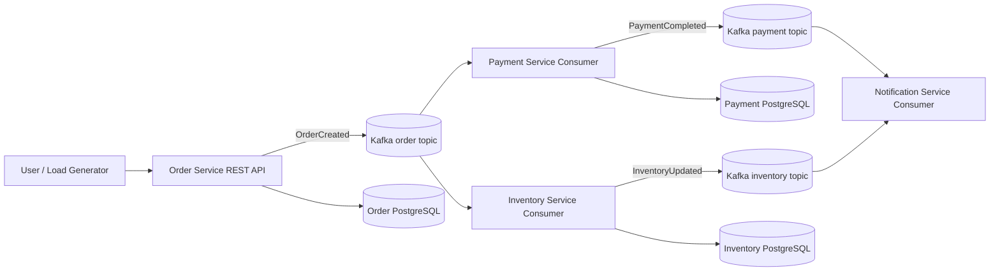
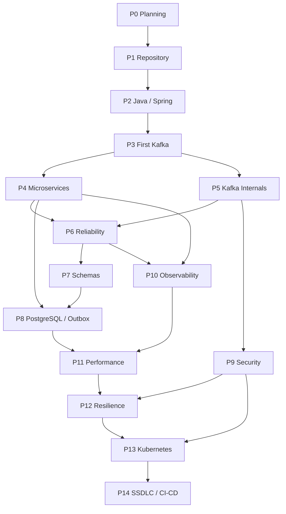
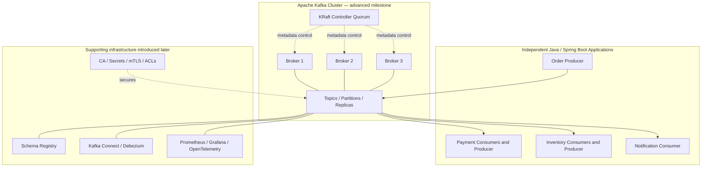
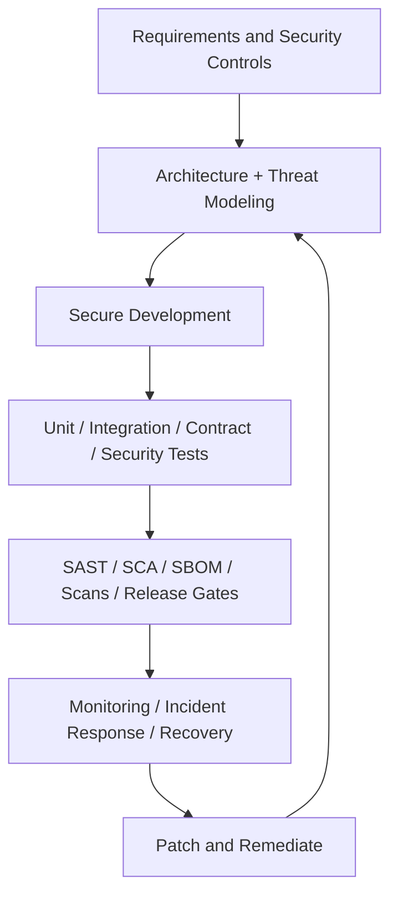

# Enterprise Kafka Learning Lab — Master Roadmap

**Planning baseline:** 23 November 2026  
**Goal:** A progressively evolving, enterprise-style Apache Kafka lab for learning, experimentation and SSDLC practice—not a production business application.  
**Scale scenario:** Approximately 100,000 application users; event rates and capacity must be modeled and measured rather than assumed.  
**Schedule:** Flexible.

## Finalized decisions

| Topic | Choice |
|---|---|
| Repository | Monorepo |
| Language / framework | Java + Spring Boot |
| Kafka | Apache Kafka using KRaft |
| Kafka clients | Native Java clients first, then Spring Kafka |
| Data | PostgreSQL (introduced when persistence patterns are studied) |
| Development | Docker Compose |
| Advanced deployment | Kubernetes |
| Security | Progressive, culminating in TLS, mTLS, SASL, ACLs and certificate management |
| Engineering depth | Enterprise-level, with testing, observability, resilience, performance and SSDLC |

## Learning principles

1. Start with one Kafka broker, one producer, one consumer and one topic.
2. Understand the native Kafka client before abstracting it with Spring Kafka.
3. Keep simulated e-commerce business logic intentionally basic.
4. Create separate services only when they serve an architectural or learning purpose.
5. For each capability: study → implement → verify → break intentionally → observe → document.
6. Include negative security tests, failure experiments and documented evidence.
7. Treat scalability as an evidence-based workload exercise.

## Architecture at a glance




See [architecture and repository blueprint](ARCHITECTURE.md) for infrastructure topology, trust boundaries and monorepo structure.

## Implementation progression




## Detailed phase documents

| Phase | Tasks | Exit deliverable |
|---|---:|---|
| [P0 — Initiation, requirements and architecture](phases/P0_initiation-requirements-and-architecture.md) | 45 | Approved project charter, requirements, context/component diagrams, STRIDE model and ADRs |
| [P1 — Repository and development environment](phases/P1_repository-and-development-environment.md) | 43 | Initialized monorepo, coding standards, repeatable setup and passing CI |
| [P2 — Java and Spring Boot foundations](phases/P2_java-and-spring-boot-foundations.md) | 34 | Tested and containerized Spring Boot starter application |
| [P3 — First Kafka producer and consumer](phases/P3_first-kafka-producer-and-consumer.md) | 66 | Working local Kafka single-broker lab with CLI, native Java and Spring Kafka message flows |
| [P4 — Microservices and event-driven architecture](phases/P4_microservices-and-event-driven-architecture.md) | 43 | Independent order/payment/inventory/notification applications exchanging events |
| [P5 — Kafka internals and administration](phases/P5_kafka-internals-and-administration.md) | 42 | Multi-broker KRaft lab with replication and recovery findings |
| [P6 — Reliability, consistency and delivery guarantees](phases/P6_reliability-consistency-and-delivery-guarantees.md) | 55 | Failure-tested delivery/retry/DLT, transaction and deduplication demonstrations |
| [P7 — Event contracts and schema management](phases/P7_event-contracts-and-schema-management.md) | 37 | Governed event schema library and CI compatibility verification |
| [P8 — PostgreSQL and distributed consistency](phases/P8_postgresql-and-distributed-consistency.md) | 49 | Independent PostgreSQL data stores, Outbox and CDC demonstrations and Saga experiment |
| [P9 — Security: TLS, mTLS, SASL and ACLs](phases/P9_security-tls-mtls-sasl-and-acls.md) | 64 | Authenticated encrypted connections, ACL matrix, PKI processes and negative security tests |
| [P10 — Observability and operations](phases/P10_observability-and-operations.md) | 44 | Metrics dashboards, centralized logs, end-to-end traces and alert rules |
| [P11 — Performance, throughput and scalability](phases/P11_performance-throughput-and-scalability.md) | 47 | Load-test results, tuning comparison and capacity planning worksheet |
| [P12 — Resilience and disaster recovery](phases/P12_resilience-and-disaster-recovery.md) | 40 | Failure injection report, DR plan, RPO/RTO goals and tested runbooks |
| [P13 — Kubernetes and enterprise deployment](phases/P13_kubernetes-and-enterprise-deployment.md) | 65 | Repeatable Kubernetes and Helm lab with network and workload security controls |
| [P14 — Enterprise SSDLC, CI/CD and final validation](phases/P14_enterprise-ssdlc-ci-cd-and-final-validation.md) | 52 | Secured CI/CD pipeline, final test evidence, operational handbook and learning report |

**Total tasks: 726.** The stable task IDs align exactly with the CSV checklist.

## Milestone and phase gate expectations

For each phase, demonstrate the phase deliverable, execute applicable tests and negative/failure experiments, collect logs or reports, maintain architecture and security notes, and update the task checklist. The more detailed gates are in each phase file.

## SSDLC and operational learning

Use [SSDLC and Verification Handbook](SSDLC_AND_VERIFICATION.md) to apply requirements, threat modeling, secure development, verification, supply-chain protection, operations and maintenance throughout the project.

## Checklist usage

The companion `Kafka_Learning_Lab_Task_Checklist.csv` contains **18 columns**, including task ID, phase, name, task type, dependencies, priority, status, owner, hours, dates, deliverable, acceptance criteria, verification, notes and evidence link. Markdown checkboxes are a readable copy; **the CSV should be the tracking source of truth**.

## Official reference links

- [Apache Kafka](https://kafka.apache.org/documentation/)
- [Spring Boot](https://docs.spring.io/spring-boot/index.html)
- [Spring Kafka](https://docs.spring.io/spring-kafka/reference/)
- [Java learning](https://dev.java/learn/)
- [PostgreSQL](https://www.postgresql.org/docs/)
- [Docker](https://docs.docker.com/)
- [Kubernetes](https://kubernetes.io/docs/home/)
- [OpenTelemetry](https://opentelemetry.io/docs/)
- [Testcontainers](https://java.testcontainers.org/)
- [OWASP Top 10](https://owasp.org/www-project-top-ten/)


---

# System and Repository Architecture

> Source: Enterprise Kafka Learning Lab master roadmap (23 November 2026). Diagrams below are **conceptual planning diagrams**, not claims that any system is already deployed.

## Architecture principles

- Keep business logic minimal to focus on Kafka internals and engineering practices.
- Producer and consumer are application capabilities, not automatically microservices.
- Topics, partitions, consumer groups and dead-letter topics are Kafka resources.
- Evolve from one broker and one message to independently deployable services and a multi-broker KRaft cluster.
- Design trust boundaries early; implement controls progressively.
- Avoid sharing business-specific libraries across service boundaries.

## Logical end-to-end event flow


## Event and infrastructure topology




In the initial milestone, only a single Kafka broker, one simple application, one producer, one consumer and one topic are required. The remaining components are learning targets introduced later.

## Architecture layers

| Layer | Components |
|---|---|
| Business services | Order, Payment, Inventory, Notification, event generator |
| Kafka data plane | Brokers, producers, consumers, partitions, replicas, consumer groups, topics, DLT |
| Kafka control plane | KRaft metadata and controllers, AdminClient |
| Data and integration | PostgreSQL, Flyway, transactional Outbox, Kafka Connect, Debezium |
| Security | CA, certificate issuance and rotation, mTLS, SASL, ACLs, application identity, secrets |
| Observability | Actuator, JMX exporter, Prometheus, Grafana, tracing and log aggregation |
| Delivery | Compose, Kubernetes, Helm, CI/CD, quality and security gates |

## Repository blueprint

```text
enterprise-kafka-learning-lab/
├── README.md
├── docs/
│   ├── requirements/
│   ├── architecture/
│   │   └── decisions/
│   ├── kafka/
│   ├── security/
│   ├── operations/
│   ├── testing/
│   └── learning-notes/
├── applications/
│   ├── order-service/
│   ├── payment-service/
│   ├── inventory-service/
│   ├── notification-service/
│   ├── event-generator/
│   └── event-monitor/
├── shared/
│   ├── event-contracts/
│   ├── common-test-utils/
│   └── observability-starter/
├── infrastructure/
│   ├── docker/
│   ├── compose/
│   ├── kafka/
│   ├── postgres/
│   ├── schema-registry/
│   ├── kafka-connect/
│   ├── security/
│   ├── observability/
│   ├── kubernetes/
│   ├── helm/
│   └── terraform/
├── testing/
├── scripts/
├── .github/workflows/
└── tools/
```


Create directories as they become useful. Prefer independently built Maven applications. Secrets and private keys must not be version controlled.

## Technology decisions recorded in source roadmap

| Decision | Selected approach |
|---|---|
| Codebase | Monorepo, independent Maven modules and independently deployable services |
| Applications | Java and Spring Boot; minimal order/payment/inventory/notification simulation |
| Kafka | Apache Kafka in KRaft mode; native Java client first, Spring Kafka second |
| Persistence | PostgreSQL, later Outbox/CDC and Saga experiments |
| Deployment | Docker Compose first, Kubernetes with maintained operator later |
| Security | Progressive SSDLC: TLS, mTLS, SASL/SCRAM, Kafka ACLs, PKI and secret management |
| Quality | JUnit, Mockito, Testcontainers, security scans and contract testing |
| Operations | Prometheus, Grafana, OpenTelemetry, centralized logs and failure injection |
| Workload | Model up to 100,000 users; quantify concurrency, events/s, payloads, retention and SLOs |
| Delivery | Task-sized work, repeatable verification, ADRs, CI/CD and evidence capture |

## Security boundaries to experiment with

- Java application ↔ Kafka broker: TLS, mTLS, SASL and Kafka ACLs as separate learning exercises.
- Broker ↔ broker, KRaft controller ↔ broker: protected Kafka communications.
- Service ↔ service over HTTP: mTLS and, when required, application-level authorization.
- Service ↔ PostgreSQL: TLS, database roles and independent service ownership.
- Developer/CI ↔ infrastructure: limited administrative privileges and managed secrets.

## Architecture evolution and work dependencies


The graph indicates learning prerequisites. It is not a strict prohibition on adding early unit tests, logging, secure defaults or repository scanning.


---

# SSDLC and Verification Handbook

> Based on the SSDLC workflow, phase gates, failure experiment catalog and definition of done in the source roadmap.

## SSDLC lifecycle



## Work products and evidence

| Stage | Work products |
|---|---|
| Requirements | Scope, functional/non-functional requirements, security controls, workload profile and acceptance criteria |
| Design | System diagrams, data flows, trust boundaries, threat model and ADRs |
| Development | Secure coding rules, reviews, least privilege, secret hygiene |
| Verification | Unit, integration, contract, negative security, failure and performance tests |
| Build / Release | Dependency scans, SAST, secret scanning, image scans, SBOM, artifact verification |
| Operations | Telemetry, SLO/alert policy, incident response and recovery drills |
| Maintenance | Patching, vulnerability remediation and architecture review |

## Failure experiment catalog

- Broker outage while publishing — Producer acknowledgements, retries and ISR behavior
- Consumer crashes before/after commit — Replay, offset commits, delivery guarantees
- Duplicated message — Idempotent consumer and deduplication
- Poison message and invalid schema — Retry topology, failure metadata and DLT replay
- Expired or untrusted client certificate — TLS and mutual client authentication
- Unauthorized Kafka principal — ACL denial, audit evidence
- Outbox publisher failure — At-least-once publication and eventual delivery
- PostgreSQL outage — Transaction boundaries and consistency
- Traffic spike / consumer slowdown — Backlog, partition constraints and lag recovery
- KRaft controller quorum loss — Metadata-plane availability
- Kubernetes broker pod restart — Stable broker identity, volume and replica recovery
- Region or cluster outage — Cross-cluster replication, restore plan and RPO/RTO

## Definition of done

- [ ] Implementation or investigation completed and committed.
- [ ] Expected behavior verified and proof recorded.
- [ ] Appropriate unit, integration, contract and negative tests executed.
- [ ] Security requirements evaluated; no new credentials committed.
- [ ] Metrics/logs and error handling inspected.
- [ ] Documentation, diagrams and any ADR updated.
- [ ] Acceptance criteria met and task status updated in CSV.

## Completion evidence for each task

Record in `Kafka_Learning_Lab_Task_Checklist.csv`: status, owner, actual effort, completion date, notes and a path/URL to the verification evidence. Keep logs, test reports and security findings under project-controlled directories as appropriate. Do not commit real credentials or private certificates.


---

# Phase 0 — Initiation, requirements and architecture

[← Master roadmap](../ROADMAP.md) · [Architecture](../ARCHITECTURE.md) · [SSDLC](../SSDLC_AND_VERIFICATION.md)

## Objective

Define scope, workload, target architecture, trust boundaries, ADRs and measurable success criteria.

## Expected exit deliverable

Approved project charter, requirements, context/component diagrams, STRIDE model and ADRs

## Phase gate

demonstrate the deliverable; complete applicable tests and negative/failure experiments; capture logs or reports; update documentation and ADRs; verify the relevant SSDLC controls.

## Task checklist (45 tasks)

Task titles and IDs are retained from the source checklist. Granular tracking fields (owner, dates, acceptance criteria, dependencies and verification) are available in the accompanying CSV.

- [ ] **P0-001** — Define project objectives
- [ ] **P0-002** — Define learning objectives _(depends on: P0-001)_
- [ ] **P0-003** — Define scope boundaries _(depends on: P0-002)_
- [ ] **P0-004** — Identify in-scope technologies _(depends on: P0-003)_
- [ ] **P0-005** — Identify out-of-scope functionality _(depends on: P0-004)_
- [ ] **P0-006** — Define e-commerce simulation _(depends on: P0-005)_
- [ ] **P0-007** — Inventory logical components _(depends on: P0-006)_
- [ ] **P0-008** — Define final target architecture _(depends on: P0-007)_
- [ ] **P0-009** — Define functional requirements _(depends on: P0-008)_
- [ ] **P0-010** — Define performance requirements _(depends on: P0-009)_
- [ ] **P0-011** — Define availability requirements _(depends on: P0-010)_
- [ ] **P0-012** — Define scalability requirements _(depends on: P0-011)_
- [ ] **P0-013** — Define security requirements _(depends on: P0-012)_
- [ ] **P0-014** — Define observability requirements _(depends on: P0-013)_
- [ ] **P0-015** — Define maintainability requirements _(depends on: P0-014)_
- [ ] **P0-016** — Define deployment requirements _(depends on: P0-015)_
- [ ] **P0-017** — Define backup and recovery requirements _(depends on: P0-016)_
- [ ] **P0-018** — Define measurable acceptance criteria _(depends on: P0-017)_
- [ ] **P0-019** — Define 100,000-user scenario _(depends on: P0-018)_
- [ ] **P0-020** — Estimate concurrent users _(depends on: P0-019)_
- [ ] **P0-021** — Estimate events per user _(depends on: P0-020)_
- [ ] **P0-022** — Define baseline events per second _(depends on: P0-021)_
- [ ] **P0-023** — Define peak multiplier _(depends on: P0-022)_
- [ ] **P0-024** — Define payload size _(depends on: P0-023)_
- [ ] **P0-025** — Define event retention _(depends on: P0-024)_
- [ ] **P0-026** — Define latency objectives _(depends on: P0-025)_
- [ ] **P0-027** — Define availability objectives _(depends on: P0-026)_
- [ ] **P0-028** — Create system-context diagram _(depends on: P0-027)_
- [ ] **P0-029** — Create logical component diagram _(depends on: P0-028)_
- [ ] **P0-030** — Identify microservice boundaries _(depends on: P0-029)_
- [ ] **P0-031** — Create communication matrix _(depends on: P0-030)_
- [ ] **P0-032** — Define sync versus async messaging _(depends on: P0-031)_
- [ ] **P0-033** — Inventory Kafka infrastructure _(depends on: P0-032)_
- [ ] **P0-034** — Define deployment models _(depends on: P0-033)_
- [ ] **P0-035** — Identify trust boundaries _(depends on: P0-034)_
- [ ] **P0-036** — Create initial STRIDE threat model _(depends on: P0-035)_
- [ ] **P0-037** — ADR: monorepo _(depends on: P0-036)_
- [ ] **P0-038** — ADR: Kafka and KRaft _(depends on: P0-037)_
- [ ] **P0-039** — ADR: Java and Spring Boot versions _(depends on: P0-038)_
- [ ] **P0-040** — ADR: Maven _(depends on: P0-039)_
- [ ] **P0-041** — ADR: PostgreSQL _(depends on: P0-040)_
- [ ] **P0-042** — ADR: Docker Compose _(depends on: P0-041)_
- [ ] **P0-043** — ADR: Kubernetes _(depends on: P0-042)_
- [ ] **P0-044** — ADR: progressive security _(depends on: P0-043)_
- [ ] **P0-045** — ADR: observability _(depends on: P0-044)_

## Task-level acceptance and verification

Refer to the corresponding `Task_ID` row in `Kafka_Learning_Lab_Task_Checklist.csv` for the source acceptance criteria, verification approach, task type, priority and dependency. Record test evidence before changing the status to Done.


---

# Phase 1 — Repository and development environment

[← Master roadmap](../ROADMAP.md) · [Architecture](../ARCHITECTURE.md) · [SSDLC](../SSDLC_AND_VERIFICATION.md)

## Objective

Create a reproducible monorepo, development workstation standards and an initial continuous integration pipeline.

## Expected exit deliverable

Initialized monorepo, coding standards, repeatable setup and passing CI

## Phase gate

demonstrate the deliverable; complete applicable tests and negative/failure experiments; capture logs or reports; update documentation and ADRs; verify the relevant SSDLC controls.

## Task checklist (43 tasks)

Task titles and IDs are retained from the source checklist. Granular tracking fields (owner, dates, acceptance criteria, dependencies and verification) are available in the accompanying CSV.

- [ ] **P1-001** — Create GitHub repository _(depends on: P0-GATE)_
- [ ] **P1-002** — Write README _(depends on: P1-001)_
- [ ] **P1-003** — Configure .gitignore _(depends on: P1-002)_
- [ ] **P1-004** — Configure .editorconfig _(depends on: P1-003)_
- [ ] **P1-005** — Define branch naming _(depends on: P1-004)_
- [ ] **P1-006** — Define Conventional Commits _(depends on: P1-005)_
- [ ] **P1-007** — Define PR review rules _(depends on: P1-006)_
- [ ] **P1-008** — Create issue templates _(depends on: P1-007)_
- [ ] **P1-009** — Create PR template _(depends on: P1-008)_
- [ ] **P1-010** — Create SECURITY.md _(depends on: P1-009)_
- [ ] **P1-011** — Create CONTRIBUTING.md _(depends on: P1-010)_
- [ ] **P1-012** — Create documentation tree _(depends on: P1-011)_
- [ ] **P1-013** — Install JDK _(depends on: P1-012)_
- [ ] **P1-014** — Configure JAVA_HOME _(depends on: P1-013)_
- [ ] **P1-015** — Verify Java compiler _(depends on: P1-014)_
- [ ] **P1-016** — Install Maven _(depends on: P1-015)_
- [ ] **P1-017** — Verify Maven _(depends on: P1-016)_
- [ ] **P1-018** — Install Docker _(depends on: P1-017)_
- [ ] **P1-019** — Verify Docker Compose _(depends on: P1-018)_
- [ ] **P1-020** — Run test container _(depends on: P1-019)_
- [ ] **P1-021** — Install Git _(depends on: P1-020)_
- [ ] **P1-022** — Configure IDE _(depends on: P1-021)_
- [ ] **P1-023** — Configure Java formatter _(depends on: P1-022)_
- [ ] **P1-024** — Configure static inspections _(depends on: P1-023)_
- [ ] **P1-025** — Install Kafka CLI _(depends on: P1-024)_
- [ ] **P1-026** — Verify PostgreSQL CLI _(depends on: P1-025)_
- [ ] **P1-027** — Define package naming _(depends on: P1-026)_
- [ ] **P1-028** — Define class naming _(depends on: P1-027)_
- [ ] **P1-029** — Define exception handling standards _(depends on: P1-028)_
- [ ] **P1-030** — Define logging standards _(depends on: P1-029)_
- [ ] **P1-031** — Define configuration conventions _(depends on: P1-030)_
- [ ] **P1-032** — Define Maven dependency management _(depends on: P1-031)_
- [ ] **P1-033** — Configure compiler plugin _(depends on: P1-032)_
- [ ] **P1-034** — Configure test plugins _(depends on: P1-033)_
- [ ] **P1-035** — Configure formatter and static analysis _(depends on: P1-034)_
- [ ] **P1-036** — Define review checklist _(depends on: P1-035)_
- [ ] **P1-037** — Create GitHub Actions workflow _(depends on: P1-036)_
- [ ] **P1-038** — Configure checkout step _(depends on: P1-037)_
- [ ] **P1-039** — Configure JDK setup _(depends on: P1-038)_
- [ ] **P1-040** — Configure Maven build _(depends on: P1-039)_
- [ ] **P1-041** — Run unit tests in CI _(depends on: P1-040)_
- [ ] **P1-042** — Publish CI test artifacts _(depends on: P1-041)_
- [ ] **P1-043** — Configure CI failure reporting _(depends on: P1-042)_

## Task-level acceptance and verification

Refer to the corresponding `Task_ID` row in `Kafka_Learning_Lab_Task_Checklist.csv` for the source acceptance criteria, verification approach, task type, priority and dependency. Record test evidence before changing the status to Done.


---

# Phase 2 — Java and Spring Boot foundations

[← Master roadmap](../ROADMAP.md) · [Architecture](../ARCHITECTURE.md) · [SSDLC](../SSDLC_AND_VERIFICATION.md)

## Objective

Refresh essential Java skills and establish clean, testable Spring Boot application conventions.

## Expected exit deliverable

Tested and containerized Spring Boot starter application

## Phase gate

demonstrate the deliverable; complete applicable tests and negative/failure experiments; capture logs or reports; update documentation and ADRs; verify the relevant SSDLC controls.

## Task checklist (34 tasks)

Task titles and IDs are retained from the source checklist. Granular tracking fields (owner, dates, acceptance criteria, dependencies and verification) are available in the accompanying CSV.

- [ ] **P2-001** — Review Java project structure _(depends on: P1-GATE)_
- [ ] **P2-002** — Review Maven dependency scopes _(depends on: P2-001)_
- [ ] **P2-003** — Review interfaces and abstractions _(depends on: P2-002)_
- [ ] **P2-004** — Review dependency inversion _(depends on: P2-003)_
- [ ] **P2-005** — Review collections and generics _(depends on: P2-004)_
- [ ] **P2-006** — Review streams and lambdas _(depends on: P2-005)_
- [ ] **P2-007** — Review records and immutability _(depends on: P2-006)_
- [ ] **P2-008** — Review checked and unchecked exceptions _(depends on: P2-007)_
- [ ] **P2-009** — Review Java concurrency _(depends on: P2-008)_
- [ ] **P2-010** — Review thread pools _(depends on: P2-009)_
- [ ] **P2-011** — Review CompletableFuture _(depends on: P2-010)_
- [ ] **P2-012** — Review JVM memory basics _(depends on: P2-011)_
- [ ] **P2-013** — Review SLF4J logging _(depends on: P2-012)_
- [ ] **P2-014** — Create Spring Boot application _(depends on: P2-013)_
- [ ] **P2-015** — Understand application lifecycle _(depends on: P2-014)_
- [ ] **P2-016** — Implement dependency injection _(depends on: P2-015)_
- [ ] **P2-017** — Configure application properties _(depends on: P2-016)_
- [ ] **P2-018** — Implement environment profiles _(depends on: P2-017)_
- [ ] **P2-019** — Create REST endpoint _(depends on: P2-018)_
- [ ] **P2-020** — Validate REST requests _(depends on: P2-019)_
- [ ] **P2-021** — Add global exception handler _(depends on: P2-020)_
- [ ] **P2-022** — Implement structured logging _(depends on: P2-021)_
- [ ] **P2-023** — Enable Actuator health _(depends on: P2-022)_
- [ ] **P2-024** — Expose application metrics _(depends on: P2-023)_
- [ ] **P2-025** — Write JUnit unit tests _(depends on: P2-024)_
- [ ] **P2-026** — Write controller integration tests _(depends on: P2-025)_
- [ ] **P2-027** — Implement layered separation _(depends on: P2-026)_
- [ ] **P2-028** — Apply SOLID _(depends on: P2-027)_
- [ ] **P2-029** — Separate domain and infrastructure _(depends on: P2-028)_
- [ ] **P2-030** — Separate DTOs from domain _(depends on: P2-029)_
- [ ] **P2-031** — Validate typed configuration _(depends on: P2-030)_
- [ ] **P2-032** — Run dependency vulnerability scan _(depends on: P2-031)_
- [ ] **P2-033** — Document service _(depends on: P2-032)_
- [ ] **P2-034** — Build Docker image _(depends on: P2-033)_

## Task-level acceptance and verification

Refer to the corresponding `Task_ID` row in `Kafka_Learning_Lab_Task_Checklist.csv` for the source acceptance criteria, verification approach, task type, priority and dependency. Record test evidence before changing the status to Done.


---

# Phase 3 — First Kafka producer and consumer

[← Master roadmap](../ROADMAP.md) · [Architecture](../ARCHITECTURE.md) · [SSDLC](../SSDLC_AND_VERIFICATION.md)

## Objective

Learn Kafka with CLI and native clients before adding Spring Kafka abstractions.

## Expected exit deliverable

Working local Kafka single-broker lab with CLI, native Java and Spring Kafka message flows

## Phase gate

demonstrate the deliverable; complete applicable tests and negative/failure experiments; capture logs or reports; update documentation and ADRs; verify the relevant SSDLC controls.

## Task checklist (66 tasks)

Task titles and IDs are retained from the source checklist. Granular tracking fields (owner, dates, acceptance criteria, dependencies and verification) are available in the accompanying CSV.

- [ ] **P3-001** — Understand event streaming _(depends on: P2-GATE)_
- [ ] **P3-002** — Understand Kafka architecture _(depends on: P3-001)_
- [ ] **P3-003** — Understand broker role _(depends on: P3-002)_
- [ ] **P3-004** — Understand KRaft _(depends on: P3-003)_
- [ ] **P3-005** — Understand controller role _(depends on: P3-004)_
- [ ] **P3-006** — Understand topics _(depends on: P3-005)_
- [ ] **P3-007** — Understand partitions _(depends on: P3-006)_
- [ ] **P3-008** — Understand offsets _(depends on: P3-007)_
- [ ] **P3-009** — Understand message keys _(depends on: P3-008)_
- [ ] **P3-010** — Understand message headers _(depends on: P3-009)_
- [ ] **P3-011** — Understand record timestamps _(depends on: P3-010)_
- [ ] **P3-012** — Understand producer and consumer _(depends on: P3-011)_
- [ ] **P3-013** — Understand bootstrap servers _(depends on: P3-012)_
- [ ] **P3-014** — Understand cluster metadata _(depends on: P3-013)_
- [ ] **P3-015** — Create Kafka Compose file _(depends on: P3-014)_
- [ ] **P3-016** — Configure one-node KRaft _(depends on: P3-015)_
- [ ] **P3-017** — Start Kafka broker _(depends on: P3-016)_
- [ ] **P3-018** — Inspect container logs _(depends on: P3-017)_
- [ ] **P3-019** — Verify bootstrap connectivity _(depends on: P3-018)_
- [ ] **P3-020** — Create topic with CLI _(depends on: P3-019)_
- [ ] **P3-021** — List topics _(depends on: P3-020)_
- [ ] **P3-022** — Describe topic _(depends on: P3-021)_
- [ ] **P3-023** — Publish using console producer _(depends on: P3-022)_
- [ ] **P3-024** — Consume using console consumer _(depends on: P3-023)_
- [ ] **P3-025** — Inspect offsets _(depends on: P3-024)_
- [ ] **P3-026** — Delete test topic _(depends on: P3-025)_
- [ ] **P3-027** — Document Kafka CLI commands _(depends on: P3-026)_
- [ ] **P3-028** — Create native producer project _(depends on: P3-027)_
- [ ] **P3-029** — Add Kafka clients dependency _(depends on: P3-028)_
- [ ] **P3-030** — Configure bootstrap servers _(depends on: P3-029)_
- [ ] **P3-031** — Configure producer properties _(depends on: P3-030)_
- [ ] **P3-032** — Create event record _(depends on: P3-031)_
- [ ] **P3-033** — Implement StringSerializer _(depends on: P3-032)_
- [ ] **P3-034** — Publish first event _(depends on: P3-033)_
- [ ] **P3-035** — Verify record by CLI _(depends on: P3-034)_
- [ ] **P3-036** — Inspect send acknowledgement _(depends on: P3-035)_
- [ ] **P3-037** — Publish asynchronously _(depends on: P3-036)_
- [ ] **P3-038** — Handle send callback _(depends on: P3-037)_
- [ ] **P3-039** — Handle producer exceptions _(depends on: P3-038)_
- [ ] **P3-040** — Close producer gracefully _(depends on: P3-039)_
- [ ] **P3-041** — Test broker-unavailable behavior _(depends on: P3-040)_
- [ ] **P3-042** — Create native consumer project _(depends on: P3-041)_
- [ ] **P3-043** — Configure consumer bootstrap _(depends on: P3-042)_
- [ ] **P3-044** — Configure consumer properties _(depends on: P3-043)_
- [ ] **P3-045** — Implement deserializer _(depends on: P3-044)_
- [ ] **P3-046** — Subscribe to topic _(depends on: P3-045)_
- [ ] **P3-047** — Implement poll loop _(depends on: P3-046)_
- [ ] **P3-048** — Process polled records _(depends on: P3-047)_
- [ ] **P3-049** — Set consumer group ID _(depends on: P3-048)_
- [ ] **P3-050** — Observe auto commits _(depends on: P3-049)_
- [ ] **P3-051** — Implement manual commits _(depends on: P3-050)_
- [ ] **P3-052** — Handle consumer exceptions _(depends on: P3-051)_
- [ ] **P3-053** — Implement graceful shutdown _(depends on: P3-052)_
- [ ] **P3-054** — Test restart and replay _(depends on: P3-053)_
- [ ] **P3-055** — Add Spring Kafka dependency _(depends on: P3-054)_
- [ ] **P3-056** — Configure Spring Kafka brokers _(depends on: P3-055)_
- [ ] **P3-057** — Configure ProducerFactory _(depends on: P3-056)_
- [ ] **P3-058** — Configure KafkaTemplate _(depends on: P3-057)_
- [ ] **P3-059** — Publish with Spring Kafka _(depends on: P3-058)_
- [ ] **P3-060** — Implement @KafkaListener _(depends on: P3-059)_
- [ ] **P3-061** — Configure Spring group IDs _(depends on: P3-060)_
- [ ] **P3-062** — Configure event serialization _(depends on: P3-061)_
- [ ] **P3-063** — Configure event deserialization _(depends on: P3-062)_
- [ ] **P3-064** — Compare native and Spring clients _(depends on: P3-063)_
- [ ] **P3-065** — Test producer with unit test _(depends on: P3-064)_
- [ ] **P3-066** — Test consumer with Testcontainers _(depends on: P3-065)_

## Task-level acceptance and verification

Refer to the corresponding `Task_ID` row in `Kafka_Learning_Lab_Task_Checklist.csv` for the source acceptance criteria, verification approach, task type, priority and dependency. Record test evidence before changing the status to Done.


---

# Phase 4 — Microservices and event-driven architecture

[← Master roadmap](../ROADMAP.md) · [Architecture](../ARCHITECTURE.md) · [SSDLC](../SSDLC_AND_VERIFICATION.md)

## Objective

Split a minimal e-commerce simulation into independently deployed event producers and consumers.

## Expected exit deliverable

Independent order/payment/inventory/notification applications exchanging events

## Phase gate

demonstrate the deliverable; complete applicable tests and negative/failure experiments; capture logs or reports; update documentation and ADRs; verify the relevant SSDLC controls.

## Task checklist (43 tasks)

Task titles and IDs are retained from the source checklist. Granular tracking fields (owner, dates, acceptance criteria, dependencies and verification) are available in the accompanying CSV.

- [ ] **P4-001** — Define Order domain _(depends on: P3-GATE)_
- [ ] **P4-002** — Define Payment domain _(depends on: P4-001)_
- [ ] **P4-003** — Define Inventory domain _(depends on: P4-002)_
- [ ] **P4-004** — Create Order Service _(depends on: P4-003)_
- [ ] **P4-005** — Expose create-order endpoint _(depends on: P4-004)_
- [ ] **P4-006** — Validate order input _(depends on: P4-005)_
- [ ] **P4-007** — Create Payment Service _(depends on: P4-006)_
- [ ] **P4-008** — Simulate payment processing _(depends on: P4-007)_
- [ ] **P4-009** — Create Inventory Service _(depends on: P4-008)_
- [ ] **P4-010** — Simulate inventory checks _(depends on: P4-009)_
- [ ] **P4-011** — Create Notification Service _(depends on: P4-010)_
- [ ] **P4-012** — Simulate notification sending _(depends on: P4-011)_
- [ ] **P4-013** — Publish from Order Service _(depends on: P4-012)_
- [ ] **P4-014** — Create standalone order consumer _(depends on: P4-013)_
- [ ] **P4-015** — Publish order-created event _(depends on: P4-014)_
- [ ] **P4-016** — Consume order-created event _(depends on: P4-015)_
- [ ] **P4-017** — Trigger payment simulation _(depends on: P4-016)_
- [ ] **P4-018** — Publish payment-completed event _(depends on: P4-017)_
- [ ] **P4-019** — Consume payment-completed event _(depends on: P4-018)_
- [ ] **P4-020** — Trigger inventory operation _(depends on: P4-019)_
- [ ] **P4-021** — Publish inventory-updated event _(depends on: P4-020)_
- [ ] **P4-022** — Trigger notification processing _(depends on: P4-021)_
- [ ] **P4-023** — Verify async communication _(depends on: P4-022)_
- [ ] **P4-024** — Verify independent deployment _(depends on: P4-023)_
- [ ] **P4-025** — Explain event-driven architecture _(depends on: P4-024)_
- [ ] **P4-026** — Identify producers and subscribers _(depends on: P4-025)_
- [ ] **P4-027** — Evaluate loose coupling _(depends on: P4-026)_
- [ ] **P4-028** — Explain choreography _(depends on: P4-027)_
- [ ] **P4-029** — Explain orchestration _(depends on: P4-028)_
- [ ] **P4-030** — Compare sync and async _(depends on: P4-029)_
- [ ] **P4-031** — Explain eventual consistency _(depends on: P4-030)_
- [ ] **P4-032** — Document bounded contexts _(depends on: P4-031)_
- [ ] **P4-033** — Draw event flow _(depends on: P4-032)_
- [ ] **P4-034** — Create sequence diagrams _(depends on: P4-033)_
- [ ] **P4-035** — Run two consumers on topic _(depends on: P4-034)_
- [ ] **P4-036** — Create distinct consumer groups _(depends on: P4-035)_
- [ ] **P4-037** — Observe independent subscription _(depends on: P4-036)_
- [ ] **P4-038** — Run two consumers in one group _(depends on: P4-037)_
- [ ] **P4-039** — Observe partition allocation _(depends on: P4-038)_
- [ ] **P4-040** — Observe group rebalance _(depends on: P4-039)_
- [ ] **P4-041** — Experiment with group ID changes _(depends on: P4-040)_
- [ ] **P4-042** — Explain group coordination _(depends on: P4-041)_
- [ ] **P4-043** — Record group experiments _(depends on: P4-042)_

## Task-level acceptance and verification

Refer to the corresponding `Task_ID` row in `Kafka_Learning_Lab_Task_Checklist.csv` for the source acceptance criteria, verification approach, task type, priority and dependency. Record test evidence before changing the status to Done.


---

# Phase 5 — Kafka internals and administration

[← Master roadmap](../ROADMAP.md) · [Architecture](../ARCHITECTURE.md) · [SSDLC](../SSDLC_AND_VERIFICATION.md)

## Objective

Understand KRaft, partitions, replication, rebalancing and broker recovery through direct experiments.

## Expected exit deliverable

Multi-broker KRaft lab with replication and recovery findings

## Phase gate

demonstrate the deliverable; complete applicable tests and negative/failure experiments; capture logs or reports; update documentation and ADRs; verify the relevant SSDLC controls.

## Task checklist (42 tasks)

Task titles and IDs are retained from the source checklist. Granular tracking fields (owner, dates, acceptance criteria, dependencies and verification) are available in the accompanying CSV.

- [ ] **P5-001** — Create topics via AdminClient _(depends on: P4-GATE)_
- [ ] **P5-002** — Inspect AdminClient APIs _(depends on: P5-001)_
- [ ] **P5-003** — Configure partition count _(depends on: P5-002)_
- [ ] **P5-004** — Inspect partition placement _(depends on: P5-003)_
- [ ] **P5-005** — Publish keyed records _(depends on: P5-004)_
- [ ] **P5-006** — Observe key partition affinity _(depends on: P5-005)_
- [ ] **P5-007** — Experiment with custom partitioner _(depends on: P5-006)_
- [ ] **P5-008** — Verify per-partition ordering _(depends on: P5-007)_
- [ ] **P5-009** — Increase partition count _(depends on: P5-008)_
- [ ] **P5-010** — Observe changed key partition mappings _(depends on: P5-009)_
- [ ] **P5-011** — Inspect log segments _(depends on: P5-010)_
- [ ] **P5-012** — Understand retention _(depends on: P5-011)_
- [ ] **P5-013** — Test time-based retention _(depends on: P5-012)_
- [ ] **P5-014** — Test size-based retention _(depends on: P5-013)_
- [ ] **P5-015** — Test log compaction _(depends on: P5-014)_
- [ ] **P5-016** — Understand replica placement _(depends on: P5-015)_
- [ ] **P5-017** — Understand replication factor _(depends on: P5-016)_
- [ ] **P5-018** — Identify partition leader _(depends on: P5-017)_
- [ ] **P5-019** — Identify followers _(depends on: P5-018)_
- [ ] **P5-020** — Inspect ISR _(depends on: P5-019)_
- [ ] **P5-021** — Understand high watermark _(depends on: P5-020)_
- [ ] **P5-022** — Observe leader election _(depends on: P5-021)_
- [ ] **P5-023** — Evaluate unclean leader election _(depends on: P5-022)_
- [ ] **P5-024** — Inspect broker registration _(depends on: P5-023)_
- [ ] **P5-025** — Understand KRaft quorum _(depends on: P5-024)_
- [ ] **P5-026** — Inspect controller responsibilities _(depends on: P5-025)_
- [ ] **P5-027** — Explore cluster metadata _(depends on: P5-026)_
- [ ] **P5-028** — Expose broker metrics _(depends on: P5-027)_
- [ ] **P5-029** — Design multi-broker conversion _(depends on: P5-028)_
- [ ] **P5-030** — Configure three brokers _(depends on: P5-029)_
- [ ] **P5-031** — Assign broker identities _(depends on: P5-030)_
- [ ] **P5-032** — Configure advertised listeners _(depends on: P5-031)_
- [ ] **P5-033** — Set replication policies _(depends on: P5-032)_
- [ ] **P5-034** — Create replicated topic _(depends on: P5-033)_
- [ ] **P5-035** — Inspect replica assignments _(depends on: P5-034)_
- [ ] **P5-036** — Stop leader broker _(depends on: P5-035)_
- [ ] **P5-037** — Observe new leader _(depends on: P5-036)_
- [ ] **P5-038** — Restart broker _(depends on: P5-037)_
- [ ] **P5-039** — Observe ISR recovery _(depends on: P5-038)_
- [ ] **P5-040** — Stop majority of controllers _(depends on: P5-039)_
- [ ] **P5-041** — Observe quorum failure _(depends on: P5-040)_
- [ ] **P5-042** — Document recovery findings _(depends on: P5-041)_

## Task-level acceptance and verification

Refer to the corresponding `Task_ID` row in `Kafka_Learning_Lab_Task_Checklist.csv` for the source acceptance criteria, verification approach, task type, priority and dependency. Record test evidence before changing the status to Done.


---

# Phase 6 — Reliability, consistency and delivery guarantees

[← Master roadmap](../ROADMAP.md) · [Architecture](../ARCHITECTURE.md) · [SSDLC](../SSDLC_AND_VERIFICATION.md)

## Objective

Observe duplicates and failures; implement bounded retries, DLTs, idempotency and transactions.

## Expected exit deliverable

Failure-tested delivery/retry/DLT, transaction and deduplication demonstrations

## Phase gate

demonstrate the deliverable; complete applicable tests and negative/failure experiments; capture logs or reports; update documentation and ADRs; verify the relevant SSDLC controls.

## Task checklist (55 tasks)

Task titles and IDs are retained from the source checklist. Granular tracking fields (owner, dates, acceptance criteria, dependencies and verification) are available in the accompanying CSV.

- [ ] **P6-001** — Understand producer acks _(depends on: P5-GATE)_
- [ ] **P6-002** — Experiment with acks=0 _(depends on: P6-001)_
- [ ] **P6-003** — Experiment with acks=1 _(depends on: P6-002)_
- [ ] **P6-004** — Experiment with acks=all _(depends on: P6-003)_
- [ ] **P6-005** — Understand producer retries _(depends on: P6-004)_
- [ ] **P6-006** — Configure delivery.timeout.ms _(depends on: P6-005)_
- [ ] **P6-007** — Configure request.timeout.ms _(depends on: P6-006)_
- [ ] **P6-008** — Enable idempotent producer _(depends on: P6-007)_
- [ ] **P6-009** — Understand producer sequence IDs _(depends on: P6-008)_
- [ ] **P6-010** — Cause duplicate publish attempts _(depends on: P6-009)_
- [ ] **P6-011** — Compare idempotent behavior _(depends on: P6-010)_
- [ ] **P6-012** — Verify graceful close _(depends on: P6-011)_
- [ ] **P6-013** — Compare offset commit strategies _(depends on: P6-012)_
- [ ] **P6-014** — Implement manual acknowledgement _(depends on: P6-013)_
- [ ] **P6-015** — Crash after processing before commit _(depends on: P6-014)_
- [ ] **P6-016** — Commit before processing as controlled demonstration _(depends on: P6-015)_
- [ ] **P6-017** — Crash consumer mid-processing _(depends on: P6-016)_
- [ ] **P6-018** — Observe redelivery _(depends on: P6-017)_
- [ ] **P6-019** — Demonstrate at-most-once caveat _(depends on: P6-018)_
- [ ] **P6-020** — Demonstrate at-least-once _(depends on: P6-019)_
- [ ] **P6-021** — Understand exactly-once boundaries _(depends on: P6-020)_
- [ ] **P6-022** — Make handler idempotent _(depends on: P6-021)_
- [ ] **P6-023** — Implement event ID deduplication _(depends on: P6-022)_
- [ ] **P6-024** — Persist deduplication keys _(depends on: P6-023)_
- [ ] **P6-025** — Classify transient/permanent errors _(depends on: P6-024)_
- [ ] **P6-026** — Implement simple retry _(depends on: P6-025)_
- [ ] **P6-027** — Configure backoff _(depends on: P6-026)_
- [ ] **P6-028** — Set max attempts _(depends on: P6-027)_
- [ ] **P6-029** — Configure retry topic _(depends on: P6-028)_
- [ ] **P6-030** — Implement exponential retry _(depends on: P6-029)_
- [ ] **P6-031** — Introduce dead-letter topic _(depends on: P6-030)_
- [ ] **P6-032** — Preserve original headers _(depends on: P6-031)_
- [ ] **P6-033** — Capture failure metadata _(depends on: P6-032)_
- [ ] **P6-034** — Build DLT replay utility _(depends on: P6-033)_
- [ ] **P6-035** — Inject poison message _(depends on: P6-034)_
- [ ] **P6-036** — Inject malformed payload _(depends on: P6-035)_
- [ ] **P6-037** — Simulate downstream outage _(depends on: P6-036)_
- [ ] **P6-038** — Document error routing _(depends on: P6-037)_
- [ ] **P6-039** — Define ordering guarantees _(depends on: P6-038)_
- [ ] **P6-040** — Enforce ordering by key _(depends on: P6-039)_
- [ ] **P6-041** — Increase listener concurrency _(depends on: P6-040)_
- [ ] **P6-042** — Observe ordering impact _(depends on: P6-041)_
- [ ] **P6-043** — Explain partition concurrency _(depends on: P6-042)_
- [ ] **P6-044** — Throttle consumer processing _(depends on: P6-043)_
- [ ] **P6-045** — Inspect consumer lag _(depends on: P6-044)_
- [ ] **P6-046** — Alert on lag _(depends on: P6-045)_
- [ ] **P6-047** — Explain Kafka transactions _(depends on: P6-046)_
- [ ] **P6-048** — Configure transactional producer _(depends on: P6-047)_
- [ ] **P6-049** — Publish batch transaction _(depends on: P6-048)_
- [ ] **P6-050** — Abort failing transaction _(depends on: P6-049)_
- [ ] **P6-051** — Implement Kafka-to-Kafka transaction _(depends on: P6-050)_
- [ ] **P6-052** — Set read_committed _(depends on: P6-051)_
- [ ] **P6-053** — Observe transactional fencing _(depends on: P6-052)_
- [ ] **P6-054** — Test exactly-once scope _(depends on: P6-053)_
- [ ] **P6-055** — Document transaction limitations _(depends on: P6-054)_

## Task-level acceptance and verification

Refer to the corresponding `Task_ID` row in `Kafka_Learning_Lab_Task_Checklist.csv` for the source acceptance criteria, verification approach, task type, priority and dependency. Record test evidence before changing the status to Done.


---

# Phase 7 — Event contracts and schema management

[← Master roadmap](../ROADMAP.md) · [Architecture](../ARCHITECTURE.md) · [SSDLC](../SSDLC_AND_VERIFICATION.md)

## Objective

Establish interoperable event contracts, schema compatibility rules and contract tests.

## Expected exit deliverable

Governed event schema library and CI compatibility verification

## Phase gate

demonstrate the deliverable; complete applicable tests and negative/failure experiments; capture logs or reports; update documentation and ADRs; verify the relevant SSDLC controls.

## Task checklist (37 tasks)

Task titles and IDs are retained from the source checklist. Granular tracking fields (owner, dates, acceptance criteria, dependencies and verification) are available in the accompanying CSV.

- [ ] **P7-001** — Define event naming _(depends on: P6-GATE)_
- [ ] **P7-002** — Define event envelope _(depends on: P7-001)_
- [ ] **P7-003** — Define unique event ID _(depends on: P7-002)_
- [ ] **P7-004** — Define correlation ID _(depends on: P7-003)_
- [ ] **P7-005** — Define causation ID _(depends on: P7-004)_
- [ ] **P7-006** — Define event timestamp _(depends on: P7-005)_
- [ ] **P7-007** — Define schema versioning _(depends on: P7-006)_
- [ ] **P7-008** — Define metadata fields _(depends on: P7-007)_
- [ ] **P7-009** — Assign schema owners _(depends on: P7-008)_
- [ ] **P7-010** — Assign topic owners _(depends on: P7-009)_
- [ ] **P7-011** — Compare serialization formats _(depends on: P7-010)_
- [ ] **P7-012** — Compare JSON and Avro _(depends on: P7-011)_
- [ ] **P7-013** — Compare Avro and Protobuf _(depends on: P7-012)_
- [ ] **P7-014** — Implement JSON codec _(depends on: P7-013)_
- [ ] **P7-015** — Implement Avro codec _(depends on: P7-014)_
- [ ] **P7-016** — Implement Protobuf codec _(depends on: P7-015)_
- [ ] **P7-017** — Measure payload sizes _(depends on: P7-016)_
- [ ] **P7-018** — Benchmark codecs _(depends on: P7-017)_
- [ ] **P7-019** — Explain schema registry _(depends on: P7-018)_
- [ ] **P7-020** — Choose Apache-compatible registry _(depends on: P7-019)_
- [ ] **P7-021** — Deploy registry _(depends on: P7-020)_
- [ ] **P7-022** — Configure registry-aware serializer _(depends on: P7-021)_
- [ ] **P7-023** — Register first schema _(depends on: P7-022)_
- [ ] **P7-024** — Retrieve schema versions _(depends on: P7-023)_
- [ ] **P7-025** — Set compatibility mode _(depends on: P7-024)_
- [ ] **P7-026** — Test backward compatibility _(depends on: P7-025)_
- [ ] **P7-027** — Test forward compatibility _(depends on: P7-026)_
- [ ] **P7-028** — Test full compatibility _(depends on: P7-027)_
- [ ] **P7-029** — Evolve a schema _(depends on: P7-028)_
- [ ] **P7-030** — Reject incompatible schema _(depends on: P7-029)_
- [ ] **P7-031** — Document schema policy _(depends on: P7-030)_
- [ ] **P7-032** — Design contract tests _(depends on: P7-031)_
- [ ] **P7-033** — Implement producer contract test _(depends on: P7-032)_
- [ ] **P7-034** — Implement consumer contract test _(depends on: P7-033)_
- [ ] **P7-035** — Run compatibility check in CI _(depends on: P7-034)_
- [ ] **P7-036** — Exercise schema evolution _(depends on: P7-035)_
- [ ] **P7-037** — Document breaking changes _(depends on: P7-036)_

## Task-level acceptance and verification

Refer to the corresponding `Task_ID` row in `Kafka_Learning_Lab_Task_Checklist.csv` for the source acceptance criteria, verification approach, task type, priority and dependency. Record test evidence before changing the status to Done.


---

# Phase 8 — PostgreSQL and distributed consistency

[← Master roadmap](../ROADMAP.md) · [Architecture](../ARCHITECTURE.md) · [SSDLC](../SSDLC_AND_VERIFICATION.md)

## Objective

Learn DB-per-service, transactional outbox, CDC and compensating distributed workflows.

## Expected exit deliverable

Independent PostgreSQL data stores, Outbox and CDC demonstrations and Saga experiment

## Phase gate

demonstrate the deliverable; complete applicable tests and negative/failure experiments; capture logs or reports; update documentation and ADRs; verify the relevant SSDLC controls.

## Task checklist (49 tasks)

Task titles and IDs are retained from the source checklist. Granular tracking fields (owner, dates, acceptance criteria, dependencies and verification) are available in the accompanying CSV.

- [ ] **P8-001** — Deploy PostgreSQL _(depends on: P7-GATE)_
- [ ] **P8-002** — Create separate service databases _(depends on: P8-001)_
- [ ] **P8-003** — Create least-privilege DB accounts _(depends on: P8-002)_
- [ ] **P8-004** — Configure JDBC connection _(depends on: P8-003)_
- [ ] **P8-005** — Integrate Spring Data JPA _(depends on: P8-004)_
- [ ] **P8-006** — Create JPA entities _(depends on: P8-005)_
- [ ] **P8-007** — Implement repositories _(depends on: P8-006)_
- [ ] **P8-008** — Create Flyway migrations _(depends on: P8-007)_
- [ ] **P8-009** — Configure HikariCP _(depends on: P8-008)_
- [ ] **P8-010** — Demonstrate DB transactions _(depends on: P8-009)_
- [ ] **P8-011** — Test DB outage _(depends on: P8-010)_
- [ ] **P8-012** — Expose database health _(depends on: P8-011)_
- [ ] **P8-013** — Explain database per service _(depends on: P8-012)_
- [ ] **P8-014** — Document data ownership _(depends on: P8-013)_
- [ ] **P8-015** — Prevent cross-service table access _(depends on: P8-014)_
- [ ] **P8-016** — Persist service-local state _(depends on: P8-015)_
- [ ] **P8-017** — Demonstrate eventual consistency _(depends on: P8-016)_
- [ ] **P8-018** — Test data convergence _(depends on: P8-017)_
- [ ] **P8-019** — Explain dual-write problem _(depends on: P8-018)_
- [ ] **P8-020** — Reproduce dual-write inconsistency _(depends on: P8-019)_
- [ ] **P8-021** — Design transactional outbox _(depends on: P8-020)_
- [ ] **P8-022** — Create outbox table _(depends on: P8-021)_
- [ ] **P8-023** — Store entity and outbox row atomically _(depends on: P8-022)_
- [ ] **P8-024** — Build polling publisher _(depends on: P8-023)_
- [ ] **P8-025** — Publish pending outbox rows _(depends on: P8-024)_
- [ ] **P8-026** — Mark published rows _(depends on: P8-025)_
- [ ] **P8-027** — Recover polling publisher _(depends on: P8-026)_
- [ ] **P8-028** — Deduplicate publication side effects _(depends on: P8-027)_
- [ ] **P8-029** — Measure polling costs _(depends on: P8-028)_
- [ ] **P8-030** — Explain change data capture _(depends on: P8-029)_
- [ ] **P8-031** — Explain WAL/logical decoding _(depends on: P8-030)_
- [ ] **P8-032** — Deploy Kafka Connect _(depends on: P8-031)_
- [ ] **P8-033** — Introduce Debezium _(depends on: P8-032)_
- [ ] **P8-034** — Enable PostgreSQL logical replication _(depends on: P8-033)_
- [ ] **P8-035** — Configure Debezium connector _(depends on: P8-034)_
- [ ] **P8-036** — Capture outbox rows _(depends on: P8-035)_
- [ ] **P8-037** — Route CDC events to Kafka _(depends on: P8-036)_
- [ ] **P8-038** — Compare polling versus CDC _(depends on: P8-037)_
- [ ] **P8-039** — Restart connector _(depends on: P8-038)_
- [ ] **P8-040** — Validate connector recovery _(depends on: P8-039)_
- [ ] **P8-041** — Explain distributed transactions _(depends on: P8-040)_
- [ ] **P8-042** — Explain Saga pattern _(depends on: P8-041)_
- [ ] **P8-043** — Design order saga _(depends on: P8-042)_
- [ ] **P8-044** — Implement choreography saga _(depends on: P8-043)_
- [ ] **P8-045** — Implement compensation _(depends on: P8-044)_
- [ ] **P8-046** — Simulate payment failure _(depends on: P8-045)_
- [ ] **P8-047** — Simulate inventory failure _(depends on: P8-046)_
- [ ] **P8-048** — Handle saga timeouts _(depends on: P8-047)_
- [ ] **P8-049** — Compare choreography and orchestration _(depends on: P8-048)_

## Task-level acceptance and verification

Refer to the corresponding `Task_ID` row in `Kafka_Learning_Lab_Task_Checklist.csv` for the source acceptance criteria, verification approach, task type, priority and dependency. Record test evidence before changing the status to Done.


---

# Phase 9 — Security: TLS, mTLS, SASL and ACLs

[← Master roadmap](../ROADMAP.md) · [Architecture](../ARCHITECTURE.md) · [SSDLC](../SSDLC_AND_VERIFICATION.md)

## Objective

Implement layered transport, service and Kafka identity security with auditable least privilege.

## Expected exit deliverable

Authenticated encrypted connections, ACL matrix, PKI processes and negative security tests

## Phase gate

demonstrate the deliverable; complete applicable tests and negative/failure experiments; capture logs or reports; update documentation and ADRs; verify the relevant SSDLC controls.

## Task checklist (64 tasks)

Task titles and IDs are retained from the source checklist. Granular tracking fields (owner, dates, acceptance criteria, dependencies and verification) are available in the accompanying CSV.

- [ ] **P9-001** — Review OWASP Top 10 _(depends on: P8-GATE)_
- [ ] **P9-002** — Review secure coding _(depends on: P9-001)_
- [ ] **P9-003** — Explain authentication _(depends on: P9-002)_
- [ ] **P9-004** — Explain authorization _(depends on: P9-003)_
- [ ] **P9-005** — Explain encryption _(depends on: P9-004)_
- [ ] **P9-006** — Explore TLS handshake _(depends on: P9-005)_
- [ ] **P9-007** — Inspect X.509 certificates _(depends on: P9-006)_
- [ ] **P9-008** — Explain asymmetric keys _(depends on: P9-007)_
- [ ] **P9-009** — Verify certificate chain _(depends on: P9-008)_
- [ ] **P9-010** — Explain Certificate Authority _(depends on: P9-009)_
- [ ] **P9-011** — Explain certificate expiration _(depends on: P9-010)_
- [ ] **P9-012** — Document trust boundaries _(depends on: P9-011)_
- [ ] **P9-013** — Map Kafka listeners _(depends on: P9-012)_
- [ ] **P9-014** — Generate lab CA _(depends on: P9-013)_
- [ ] **P9-015** — Issue broker certificates _(depends on: P9-014)_
- [ ] **P9-016** — Configure broker keystore _(depends on: P9-015)_
- [ ] **P9-017** — Configure broker truststore _(depends on: P9-016)_
- [ ] **P9-018** — Enable Kafka TLS listener _(depends on: P9-017)_
- [ ] **P9-019** — Configure TLS producer _(depends on: P9-018)_
- [ ] **P9-020** — Configure TLS consumer _(depends on: P9-019)_
- [ ] **P9-021** — Verify traffic encryption _(depends on: P9-020)_
- [ ] **P9-022** — Reject untrusted server certificate _(depends on: P9-021)_
- [ ] **P9-023** — Test expired server certificate _(depends on: P9-022)_
- [ ] **P9-024** — Write TLS troubleshooting guide _(depends on: P9-023)_
- [ ] **P9-025** — Explain mutual TLS _(depends on: P9-024)_
- [ ] **P9-026** — Inspect client-auth exchange _(depends on: P9-025)_
- [ ] **P9-027** — Issue service-specific certificates _(depends on: P9-026)_
- [ ] **P9-028** — Require broker client certificate _(depends on: P9-027)_
- [ ] **P9-029** — Configure Order Service mTLS _(depends on: P9-028)_
- [ ] **P9-030** — Configure Payment Service mTLS _(depends on: P9-029)_
- [ ] **P9-031** — Configure consumer mTLS _(depends on: P9-030)_
- [ ] **P9-032** — Map certificate to Kafka identity _(depends on: P9-031)_
- [ ] **P9-033** — Reject missing client certificate _(depends on: P9-032)_
- [ ] **P9-034** — Reject untrusted certificate _(depends on: P9-033)_
- [ ] **P9-035** — Rotate client certificate _(depends on: P9-034)_
- [ ] **P9-036** — Investigate certificate revocation constraints _(depends on: P9-035)_
- [ ] **P9-037** — Test cert renewal behavior _(depends on: P9-036)_
- [ ] **P9-038** — Document PKI lifecycle _(depends on: P9-037)_
- [ ] **P9-039** — Compare SASL mechanisms _(depends on: P9-038)_
- [ ] **P9-040** — Explain SASL/PLAIN vs SCRAM _(depends on: P9-039)_
- [ ] **P9-041** — Configure SASL/SCRAM over TLS _(depends on: P9-040)_
- [ ] **P9-042** — Authenticate producer via SASL _(depends on: P9-041)_
- [ ] **P9-043** — Authenticate consumer via SASL _(depends on: P9-042)_
- [ ] **P9-044** — Configure StandardAuthorizer _(depends on: P9-043)_
- [ ] **P9-045** — Inspect Kafka ACL syntax _(depends on: P9-044)_
- [ ] **P9-046** — Create producer ACL _(depends on: P9-045)_
- [ ] **P9-047** — Create consumer ACL _(depends on: P9-046)_
- [ ] **P9-048** — Restrict topic access _(depends on: P9-047)_
- [ ] **P9-049** — Restrict consumer group access _(depends on: P9-048)_
- [ ] **P9-050** — Test unauthorized operation _(depends on: P9-049)_
- [ ] **P9-051** — Enforce least-privilege principals _(depends on: P9-050)_
- [ ] **P9-052** — Protect administrator credentials _(depends on: P9-051)_
- [ ] **P9-053** — Secure REST endpoints _(depends on: P9-052)_
- [ ] **P9-054** — Add OAuth2/JWT experiment _(depends on: P9-053)_
- [ ] **P9-055** — Evaluate Keycloak _(depends on: P9-054)_
- [ ] **P9-056** — Encrypt PostgreSQL connections _(depends on: P9-055)_
- [ ] **P9-057** — Restrict database grants _(depends on: P9-056)_
- [ ] **P9-058** — Introduce secret store _(depends on: P9-057)_
- [ ] **P9-059** — Evaluate Vault PKI _(depends on: P9-058)_
- [ ] **P9-060** — Exclude secrets from Git _(depends on: P9-059)_
- [ ] **P9-061** — Run secret scanning _(depends on: P9-060)_
- [ ] **P9-062** — Run SCA _(depends on: P9-061)_
- [ ] **P9-063** — Scan container images _(depends on: P9-062)_
- [ ] **P9-064** — Create incident response playbook _(depends on: P9-063)_

## Task-level acceptance and verification

Refer to the corresponding `Task_ID` row in `Kafka_Learning_Lab_Task_Checklist.csv` for the source acceptance criteria, verification approach, task type, priority and dependency. Record test evidence before changing the status to Done.


---

# Phase 10 — Observability and operations

[← Master roadmap](../ROADMAP.md) · [Architecture](../ARCHITECTURE.md) · [SSDLC](../SSDLC_AND_VERIFICATION.md)

## Objective

Correlate logs, metrics and traces to follow events through the distributed system.

## Expected exit deliverable

Metrics dashboards, centralized logs, end-to-end traces and alert rules

## Phase gate

demonstrate the deliverable; complete applicable tests and negative/failure experiments; capture logs or reports; update documentation and ADRs; verify the relevant SSDLC controls.

## Task checklist (44 tasks)

Task titles and IDs are retained from the source checklist. Granular tracking fields (owner, dates, acceptance criteria, dependencies and verification) are available in the accompanying CSV.

- [ ] **P10-001** — Define logging policy _(depends on: P9-GATE)_
- [ ] **P10-002** — Emit structured JSON logs _(depends on: P10-001)_
- [ ] **P10-003** — Standardize severity levels _(depends on: P10-002)_
- [ ] **P10-004** — Propagate correlation ID _(depends on: P10-003)_
- [ ] **P10-005** — Log event ID _(depends on: P10-004)_
- [ ] **P10-006** — Instrument Kafka producer logs _(depends on: P10-005)_
- [ ] **P10-007** — Instrument Kafka consumer logs _(depends on: P10-006)_
- [ ] **P10-008** — Capture processing errors _(depends on: P10-007)_
- [ ] **P10-009** — Redact sensitive log fields _(depends on: P10-008)_
- [ ] **P10-010** — Deploy Loki or equivalent _(depends on: P10-009)_
- [ ] **P10-011** — Understand JVM metrics _(depends on: P10-010)_
- [ ] **P10-012** — Inspect Kafka broker metrics _(depends on: P10-011)_
- [ ] **P10-013** — Inspect producer metrics _(depends on: P10-012)_
- [ ] **P10-014** — Inspect consumer metrics _(depends on: P10-013)_
- [ ] **P10-015** — Track consumer lag _(depends on: P10-014)_
- [ ] **P10-016** — Measure request latency _(depends on: P10-015)_
- [ ] **P10-017** — Measure throughput _(depends on: P10-016)_
- [ ] **P10-018** — Count failed records _(depends on: P10-017)_
- [ ] **P10-019** — Count retry attempts _(depends on: P10-018)_
- [ ] **P10-020** — Count DLT events _(depends on: P10-019)_
- [ ] **P10-021** — Deploy Prometheus _(depends on: P10-020)_
- [ ] **P10-022** — Expose Actuator metrics _(depends on: P10-021)_
- [ ] **P10-023** — Export Kafka JMX metrics _(depends on: P10-022)_
- [ ] **P10-024** — Build Grafana dashboards _(depends on: P10-023)_
- [ ] **P10-025** — Understand distributed traces _(depends on: P10-024)_
- [ ] **P10-026** — Explain span and trace IDs _(depends on: P10-025)_
- [ ] **P10-027** — Deploy OpenTelemetry SDK _(depends on: P10-026)_
- [ ] **P10-028** — Instrument application _(depends on: P10-027)_
- [ ] **P10-029** — Propagate W3C trace context in Kafka headers _(depends on: P10-028)_
- [ ] **P10-030** — Trace Kafka producer calls _(depends on: P10-029)_
- [ ] **P10-031** — Trace Kafka processing _(depends on: P10-030)_
- [ ] **P10-032** — Trace database operations _(depends on: P10-031)_
- [ ] **P10-033** — Deploy Tempo or Jaeger _(depends on: P10-032)_
- [ ] **P10-034** — Review end-to-end trace _(depends on: P10-033)_
- [ ] **P10-035** — Define SLIs _(depends on: P10-034)_
- [ ] **P10-036** — Define SLOs _(depends on: P10-035)_
- [ ] **P10-037** — Choose alert thresholds _(depends on: P10-036)_
- [ ] **P10-038** — Alert on consumer lag _(depends on: P10-037)_
- [ ] **P10-039** — Alert on broker failure _(depends on: P10-038)_
- [ ] **P10-040** — Alert on disk space _(depends on: P10-039)_
- [ ] **P10-041** — Alert on application errors _(depends on: P10-040)_
- [ ] **P10-042** — Alert on DLT spikes _(depends on: P10-041)_
- [ ] **P10-043** — Write alert response notes _(depends on: P10-042)_
- [ ] **P10-044** — Create operations dashboard _(depends on: P10-043)_

## Task-level acceptance and verification

Refer to the corresponding `Task_ID` row in `Kafka_Learning_Lab_Task_Checklist.csv` for the source acceptance criteria, verification approach, task type, priority and dependency. Record test evidence before changing the status to Done.


---

# Phase 11 — Performance, throughput and scalability

[← Master roadmap](../ROADMAP.md) · [Architecture](../ARCHITECTURE.md) · [SSDLC](../SSDLC_AND_VERIFICATION.md)

## Objective

Measure a modeled 100,000-user workload, establish baselines and tune with evidence.

## Expected exit deliverable

Load-test results, tuning comparison and capacity planning worksheet

## Phase gate

demonstrate the deliverable; complete applicable tests and negative/failure experiments; capture logs or reports; update documentation and ADRs; verify the relevant SSDLC controls.

## Task checklist (47 tasks)

Task titles and IDs are retained from the source checklist. Granular tracking fields (owner, dates, acceptance criteria, dependencies and verification) are available in the accompanying CSV.

- [ ] **P11-001** — Finalize workload assumptions _(depends on: P10-GATE)_
- [ ] **P11-002** — Design load scenarios _(depends on: P11-001)_
- [ ] **P11-003** — Record machine specifications _(depends on: P11-002)_
- [ ] **P11-004** — Implement load generator _(depends on: P11-003)_
- [ ] **P11-005** — Run baseline traffic _(depends on: P11-004)_
- [ ] **P11-006** — Measure producer throughput _(depends on: P11-005)_
- [ ] **P11-007** — Measure consumer throughput _(depends on: P11-006)_
- [ ] **P11-008** — Measure end-to-end latency _(depends on: P11-007)_
- [ ] **P11-009** — Measure consumer lag _(depends on: P11-008)_
- [ ] **P11-010** — Collect CPU metrics _(depends on: P11-009)_
- [ ] **P11-011** — Collect memory metrics _(depends on: P11-010)_
- [ ] **P11-012** — Collect disk metrics _(depends on: P11-011)_
- [ ] **P11-013** — Record baseline benchmark _(depends on: P11-012)_
- [ ] **P11-014** — Tune batch.size _(depends on: P11-013)_
- [ ] **P11-015** — Tune linger.ms _(depends on: P11-014)_
- [ ] **P11-016** — Compare compression codecs _(depends on: P11-015)_
- [ ] **P11-017** — Benchmark compression overhead _(depends on: P11-016)_
- [ ] **P11-018** — Change partition count _(depends on: P11-017)_
- [ ] **P11-019** — Change replication factor _(depends on: P11-018)_
- [ ] **P11-020** — Increase producer concurrency _(depends on: P11-019)_
- [ ] **P11-021** — Increase consumer concurrency _(depends on: P11-020)_
- [ ] **P11-022** — Tune fetch settings _(depends on: P11-021)_
- [ ] **P11-023** — Tune max.poll settings _(depends on: P11-022)_
- [ ] **P11-024** — Investigate slow consumers _(depends on: P11-023)_
- [ ] **P11-025** — Investigate partition skew _(depends on: P11-024)_
- [ ] **P11-026** — Record configuration comparison _(depends on: P11-025)_
- [ ] **P11-027** — Scale producer replicas _(depends on: P11-026)_
- [ ] **P11-028** — Scale consumer replicas _(depends on: P11-027)_
- [ ] **P11-029** — Identify partition ceiling _(depends on: P11-028)_
- [ ] **P11-030** — Scale broker resources _(depends on: P11-029)_
- [ ] **P11-031** — Run high-volume test _(depends on: P11-030)_
- [ ] **P11-032** — Run peak traffic test _(depends on: P11-031)_
- [ ] **P11-033** — Run soak test _(depends on: P11-032)_
- [ ] **P11-034** — Run burst test _(depends on: P11-033)_
- [ ] **P11-035** — Create consumer backlog _(depends on: P11-034)_
- [ ] **P11-036** — Measure backlog drain time _(depends on: P11-035)_
- [ ] **P11-037** — Estimate capacity _(depends on: P11-036)_
- [ ] **P11-038** — Document scaling limitations _(depends on: P11-037)_
- [ ] **P11-039** — Estimate storage _(depends on: P11-038)_
- [ ] **P11-040** — Estimate bandwidth _(depends on: P11-039)_
- [ ] **P11-041** — Estimate broker CPU _(depends on: P11-040)_
- [ ] **P11-042** — Estimate broker memory _(depends on: P11-041)_
- [ ] **P11-043** — Estimate topic partitions _(depends on: P11-042)_
- [ ] **P11-044** — Calculate replication overhead _(depends on: P11-043)_
- [ ] **P11-045** — Calculate retention storage _(depends on: P11-044)_
- [ ] **P11-046** — Recommend scaling thresholds _(depends on: P11-045)_
- [ ] **P11-047** — Compare results to SLOs _(depends on: P11-046)_

## Task-level acceptance and verification

Refer to the corresponding `Task_ID` row in `Kafka_Learning_Lab_Task_Checklist.csv` for the source acceptance criteria, verification approach, task type, priority and dependency. Record test evidence before changing the status to Done.


---

# Phase 12 — Resilience and disaster recovery

[← Master roadmap](../ROADMAP.md) · [Architecture](../ARCHITECTURE.md) · [SSDLC](../SSDLC_AND_VERIFICATION.md)

## Objective

Deliberately break infrastructure and services; document recovery, availability and DR trade-offs.

## Expected exit deliverable

Failure injection report, DR plan, RPO/RTO goals and tested runbooks

## Phase gate

demonstrate the deliverable; complete applicable tests and negative/failure experiments; capture logs or reports; update documentation and ADRs; verify the relevant SSDLC controls.

## Task checklist (40 tasks)

Task titles and IDs are retained from the source checklist. Granular tracking fields (owner, dates, acceptance criteria, dependencies and verification) are available in the accompanying CSV.

- [ ] **P12-001** — Stop active Kafka broker _(depends on: P11-GATE)_
- [ ] **P12-002** — Restart stopped broker _(depends on: P12-001)_
- [ ] **P12-003** — Stop multiple brokers _(depends on: P12-002)_
- [ ] **P12-004** — Inject network delay _(depends on: P12-003)_
- [ ] **P12-005** — Inject packet loss _(depends on: P12-004)_
- [ ] **P12-006** — Disconnect a consumer _(depends on: P12-005)_
- [ ] **P12-007** — Kill producer process _(depends on: P12-006)_
- [ ] **P12-008** — Restart PostgreSQL _(depends on: P12-007)_
- [ ] **P12-009** — Inject slow SQL _(depends on: P12-008)_
- [ ] **P12-010** — Simulate full broker disk _(depends on: P12-009)_
- [ ] **P12-011** — Simulate memory pressure _(depends on: P12-010)_
- [ ] **P12-012** — Measure recovery behavior _(depends on: P12-011)_
- [ ] **P12-013** — Define timeout policy _(depends on: P12-012)_
- [ ] **P12-014** — Configure connection timeouts _(depends on: P12-013)_
- [ ] **P12-015** — Set bounded retries _(depends on: P12-014)_
- [ ] **P12-016** — Understand circuit breakers _(depends on: P12-015)_
- [ ] **P12-017** — Apply Resilience4j to eligible calls _(depends on: P12-016)_
- [ ] **P12-018** — Evaluate bulkhead isolation _(depends on: P12-017)_
- [ ] **P12-019** — Implement graceful degradation _(depends on: P12-018)_
- [ ] **P12-020** — Implement SIGTERM shutdown _(depends on: P12-019)_
- [ ] **P12-021** — Configure readiness checks _(depends on: P12-020)_
- [ ] **P12-022** — Configure liveness checks _(depends on: P12-021)_
- [ ] **P12-023** — Test restart continuity _(depends on: P12-022)_
- [ ] **P12-024** — Inspect replica catch-up _(depends on: P12-023)_
- [ ] **P12-025** — Test partition reassignment _(depends on: P12-024)_
- [ ] **P12-026** — Monitor under-replicated partitions _(depends on: P12-025)_
- [ ] **P12-027** — Analyze unclean leader election _(depends on: P12-026)_
- [ ] **P12-028** — Write broker recovery runbook _(depends on: P12-027)_
- [ ] **P12-029** — Recover consumer group _(depends on: P12-028)_
- [ ] **P12-030** — Recover DLT records _(depends on: P12-029)_
- [ ] **P12-031** — Replay topic safely _(depends on: P12-030)_
- [ ] **P12-032** — Define RPO and RTO _(depends on: P12-031)_
- [ ] **P12-033** — Explain replication versus backup _(depends on: P12-032)_
- [ ] **P12-034** — Choose backup approach _(depends on: P12-033)_
- [ ] **P12-035** — Evaluate cross-cluster strategies _(depends on: P12-034)_
- [ ] **P12-036** — Configure MirrorMaker 2 experiment _(depends on: P12-035)_
- [ ] **P12-037** — Simulate entire cluster loss _(depends on: P12-036)_
- [ ] **P12-038** — Practice restoring environment _(depends on: P12-037)_
- [ ] **P12-039** — Write disaster recovery guide _(depends on: P12-038)_
- [ ] **P12-040** — Run DR tabletop exercise _(depends on: P12-039)_

## Task-level acceptance and verification

Refer to the corresponding `Task_ID` row in `Kafka_Learning_Lab_Task_Checklist.csv` for the source acceptance criteria, verification approach, task type, priority and dependency. Record test evidence before changing the status to Done.


---

# Phase 13 — Kubernetes and enterprise deployment

[← Master roadmap](../ROADMAP.md) · [Architecture](../ARCHITECTURE.md) · [SSDLC](../SSDLC_AND_VERIFICATION.md)

## Objective

Deploy a supported operator-managed Kafka cluster and independent applications on Kubernetes.

## Expected exit deliverable

Repeatable Kubernetes and Helm lab with network and workload security controls

## Phase gate

demonstrate the deliverable; complete applicable tests and negative/failure experiments; capture logs or reports; update documentation and ADRs; verify the relevant SSDLC controls.

## Task checklist (65 tasks)

Task titles and IDs are retained from the source checklist. Granular tracking fields (owner, dates, acceptance criteria, dependencies and verification) are available in the accompanying CSV.

- [ ] **P13-001** — Explain Kubernetes components _(depends on: P12-GATE)_
- [ ] **P13-002** — Explain control plane _(depends on: P13-001)_
- [ ] **P13-003** — Explain Pods _(depends on: P13-002)_
- [ ] **P13-004** — Explain Deployments _(depends on: P13-003)_
- [ ] **P13-005** — Explain StatefulSets _(depends on: P13-004)_
- [ ] **P13-006** — Explain Services _(depends on: P13-005)_
- [ ] **P13-007** — Explain ConfigMaps _(depends on: P13-006)_
- [ ] **P13-008** — Explain Secrets _(depends on: P13-007)_
- [ ] **P13-009** — Explain PV/PVC _(depends on: P13-008)_
- [ ] **P13-010** — Explain StorageClass _(depends on: P13-009)_
- [ ] **P13-011** — Explain Ingress _(depends on: P13-010)_
- [ ] **P13-012** — Explain requests/limits _(depends on: P13-011)_
- [ ] **P13-013** — Explain probes _(depends on: P13-012)_
- [ ] **P13-014** — Explain autoscaling _(depends on: P13-013)_
- [ ] **P13-015** — Install local Kubernetes _(depends on: P13-014)_
- [ ] **P13-016** — Compare kind and minikube _(depends on: P13-015)_
- [ ] **P13-017** — Create namespace _(depends on: P13-016)_
- [ ] **P13-018** — Deploy hello-world service _(depends on: P13-017)_
- [ ] **P13-019** — Expose ClusterIP _(depends on: P13-018)_
- [ ] **P13-020** — Test persistent volume _(depends on: P13-019)_
- [ ] **P13-021** — Configure env vars _(depends on: P13-020)_
- [ ] **P13-022** — Configure limits _(depends on: P13-021)_
- [ ] **P13-023** — Configure probes _(depends on: P13-022)_
- [ ] **P13-024** — Evaluate Kafka deployment choices _(depends on: P13-023)_
- [ ] **P13-025** — Compare operators and manifests _(depends on: P13-024)_
- [ ] **P13-026** — Choose maintained Kafka operator _(depends on: P13-025)_
- [ ] **P13-027** — Deploy KRaft Kafka on Kubernetes _(depends on: P13-026)_
- [ ] **P13-028** — Configure persistent broker storage _(depends on: P13-027)_
- [ ] **P13-029** — Configure Kafka listeners _(depends on: P13-028)_
- [ ] **P13-030** — Configure health and readiness _(depends on: P13-029)_
- [ ] **P13-031** — Configure broker resources _(depends on: P13-030)_
- [ ] **P13-032** — Deploy multi-broker Kafka _(depends on: P13-031)_
- [ ] **P13-033** — Verify replicated topic _(depends on: P13-032)_
- [ ] **P13-034** — Restart broker pod _(depends on: P13-033)_
- [ ] **P13-035** — Recover persistent broker state _(depends on: P13-034)_
- [ ] **P13-036** — Create microservice Deployments _(depends on: P13-035)_
- [ ] **P13-037** — Create microservice Services _(depends on: P13-036)_
- [ ] **P13-038** — Deploy Order Service _(depends on: P13-037)_
- [ ] **P13-039** — Deploy Payment Service _(depends on: P13-038)_
- [ ] **P13-040** — Deploy Inventory Service _(depends on: P13-039)_
- [ ] **P13-041** — Deploy Notification Service _(depends on: P13-040)_
- [ ] **P13-042** — Deploy lab PostgreSQL _(depends on: P13-041)_
- [ ] **P13-043** — Connect workloads to Kafka _(depends on: P13-042)_
- [ ] **P13-044** — Configure persistent volumes _(depends on: P13-043)_
- [ ] **P13-045** — Configure app resource limits _(depends on: P13-044)_
- [ ] **P13-046** — Verify application horizontal scaling _(depends on: P13-045)_
- [ ] **P13-047** — Configure Kubernetes RBAC _(depends on: P13-046)_
- [ ] **P13-048** — Configure service accounts _(depends on: P13-047)_
- [ ] **P13-049** — Use non-root containers _(depends on: P13-048)_
- [ ] **P13-050** — Define network policies _(depends on: P13-049)_
- [ ] **P13-051** — Restrict namespace permissions _(depends on: P13-050)_
- [ ] **P13-052** — Integrate secret provider _(depends on: P13-051)_
- [ ] **P13-053** — Integrate cert-manager or equivalent _(depends on: P13-052)_
- [ ] **P13-054** — Apply Pod Security standards _(depends on: P13-053)_
- [ ] **P13-055** — Scan manifests _(depends on: P13-054)_
- [ ] **P13-056** — Test workload access _(depends on: P13-055)_
- [ ] **P13-057** — Create Helm chart _(depends on: P13-056)_
- [ ] **P13-058** — Parameterize application values _(depends on: P13-057)_
- [ ] **P13-059** — Parameterize Kafka connection values _(depends on: P13-058)_
- [ ] **P13-060** — Create dev values _(depends on: P13-059)_
- [ ] **P13-061** — Create enterprise-like values _(depends on: P13-060)_
- [ ] **P13-062** — Deploy with Helm _(depends on: P13-061)_
- [ ] **P13-063** — Upgrade Helm release _(depends on: P13-062)_
- [ ] **P13-064** — Rollback Helm release _(depends on: P13-063)_
- [ ] **P13-065** — Write operations guide _(depends on: P13-064)_

## Task-level acceptance and verification

Refer to the corresponding `Task_ID` row in `Kafka_Learning_Lab_Task_Checklist.csv` for the source acceptance criteria, verification approach, task type, priority and dependency. Record test evidence before changing the status to Done.


---

# Phase 14 — Enterprise SSDLC, CI/CD and final validation

[← Master roadmap](../ROADMAP.md) · [Architecture](../ARCHITECTURE.md) · [SSDLC](../SSDLC_AND_VERIFICATION.md)

## Objective

Automate secure build, tests, scans, release verification, operational runbooks and final validation.

## Expected exit deliverable

Secured CI/CD pipeline, final test evidence, operational handbook and learning report

## Phase gate

demonstrate the deliverable; complete applicable tests and negative/failure experiments; capture logs or reports; update documentation and ADRs; verify the relevant SSDLC controls.

## Task checklist (52 tasks)

Task titles and IDs are retained from the source checklist. Granular tracking fields (owner, dates, acceptance criteria, dependencies and verification) are available in the accompanying CSV.

- [ ] **P14-001** — Design CI/CD workflow _(depends on: P13-GATE)_
- [ ] **P14-002** — Build services independently _(depends on: P14-001)_
- [ ] **P14-003** — Run unit tests in CI _(depends on: P14-002)_
- [ ] **P14-004** — Run Testcontainers integration tests _(depends on: P14-003)_
- [ ] **P14-005** — Run event contract tests _(depends on: P14-004)_
- [ ] **P14-006** — Check schema compatibility _(depends on: P14-005)_
- [ ] **P14-007** — Run SAST _(depends on: P14-006)_
- [ ] **P14-008** — Run SCA _(depends on: P14-007)_
- [ ] **P14-009** — Run secret detection _(depends on: P14-008)_
- [ ] **P14-010** — Build Docker images _(depends on: P14-009)_
- [ ] **P14-011** — Scan images _(depends on: P14-010)_
- [ ] **P14-012** — Generate SBOM _(depends on: P14-011)_
- [ ] **P14-013** — Publish signed artifacts _(depends on: P14-012)_
- [ ] **P14-014** — Automate deployment _(depends on: P14-013)_
- [ ] **P14-015** — Run smoke tests _(depends on: P14-014)_
- [ ] **P14-016** — Automate rollback plan _(depends on: P14-015)_
- [ ] **P14-017** — Explain supply-chain risks _(depends on: P14-016)_
- [ ] **P14-018** — Set dependency update rules _(depends on: P14-017)_
- [ ] **P14-019** — Pin dependency versions _(depends on: P14-018)_
- [ ] **P14-020** — Capture provenance _(depends on: P14-019)_
- [ ] **P14-021** — Sign OCI image _(depends on: P14-020)_
- [ ] **P14-022** — Define vulnerability policy _(depends on: P14-021)_
- [ ] **P14-023** — Define remediation timeline _(depends on: P14-022)_
- [ ] **P14-024** — Verify provenance at deploy _(depends on: P14-023)_
- [ ] **P14-025** — Write service runbooks _(depends on: P14-024)_
- [ ] **P14-026** — Write Kafka runbooks _(depends on: P14-025)_
- [ ] **P14-027** — Write security incident runbook _(depends on: P14-026)_
- [ ] **P14-028** — Write certificate rotation runbook _(depends on: P14-027)_
- [ ] **P14-029** — Write backup/recovery runbook _(depends on: P14-028)_
- [ ] **P14-030** — Produce capacity report _(depends on: P14-029)_
- [ ] **P14-031** — Publish SLOs _(depends on: P14-030)_
- [ ] **P14-032** — Define incident severities _(depends on: P14-031)_
- [ ] **P14-033** — Document change control _(depends on: P14-032)_
- [ ] **P14-034** — Document release flow _(depends on: P14-033)_
- [ ] **P14-035** — Verify event lifecycle _(depends on: P14-034)_
- [ ] **P14-036** — Verify producer reliability _(depends on: P14-035)_
- [ ] **P14-037** — Verify consumer reliability _(depends on: P14-036)_
- [ ] **P14-038** — Verify retries and DLT _(depends on: P14-037)_
- [ ] **P14-039** — Verify schema compatibility _(depends on: P14-038)_
- [ ] **P14-040** — Verify data consistency _(depends on: P14-039)_
- [ ] **P14-041** — Verify Outbox/CDC _(depends on: P14-040)_
- [ ] **P14-042** — Verify TLS _(depends on: P14-041)_
- [ ] **P14-043** — Verify mTLS _(depends on: P14-042)_
- [ ] **P14-044** — Verify ACLs _(depends on: P14-043)_
- [ ] **P14-045** — Verify certificate rotation _(depends on: P14-044)_
- [ ] **P14-046** — Verify metrics/logs/traces _(depends on: P14-045)_
- [ ] **P14-047** — Verify performance SLOs _(depends on: P14-046)_
- [ ] **P14-048** — Verify failure recovery _(depends on: P14-047)_
- [ ] **P14-049** — Verify Kubernetes _(depends on: P14-048)_
- [ ] **P14-050** — Verify CI security gates _(depends on: P14-049)_
- [ ] **P14-051** — Publish final system architecture _(depends on: P14-050)_
- [ ] **P14-052** — Write learning retrospective _(depends on: P14-051)_

## Task-level acceptance and verification

Refer to the corresponding `Task_ID` row in `Kafka_Learning_Lab_Task_Checklist.csv` for the source acceptance criteria, verification approach, task type, priority and dependency. Record test evidence before changing the status to Done.
