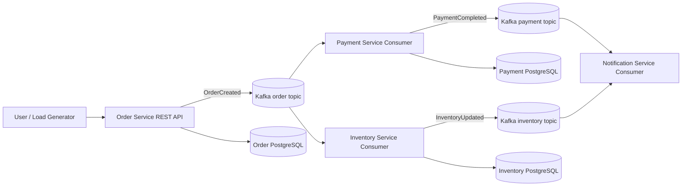
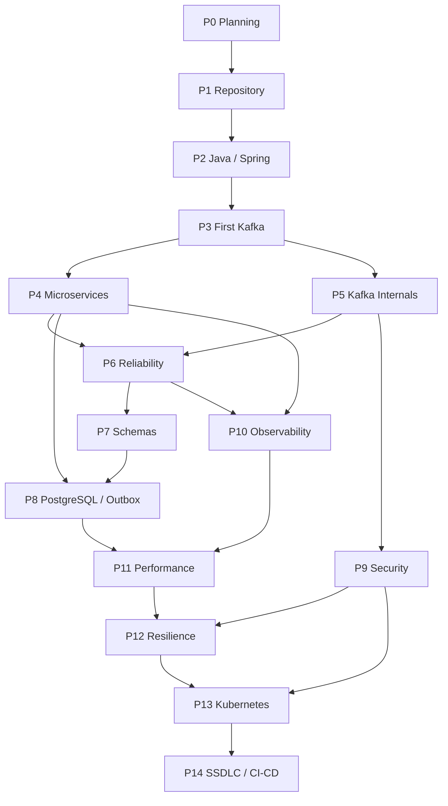

# Enterprise Kafka Learning Lab — Master Roadmap

**Planning baseline:** 23 November 2026  
**Goal:** A progressively evolving, enterprise-style Apache Kafka lab for learning, experimentation and SSDLC practice—not a production business application.  
**Scale scenario:** Approximately 100,000 application users; event rates and capacity must be modeled and measured rather than assumed.  
**Schedule:** Flexible.

## Finalized decisions

| Topic | Choice |
|---|---|
| Repository | Monorepo |
| Language / framework | Java + Spring Boot |
| Kafka | Apache Kafka using KRaft |
| Kafka clients | Native Java clients first, then Spring Kafka |
| Data | PostgreSQL (introduced when persistence patterns are studied) |
| Development | Docker Compose |
| Advanced deployment | Kubernetes |
| Security | Progressive, culminating in TLS, mTLS, SASL, ACLs and certificate management |
| Engineering depth | Enterprise-level, with testing, observability, resilience, performance and SSDLC |

## Learning principles

1. Start with one Kafka broker, one producer, one consumer and one topic.
2. Understand the native Kafka client before abstracting it with Spring Kafka.
3. Keep simulated e-commerce business logic intentionally basic.
4. Create separate services only when they serve an architectural or learning purpose.
5. For each capability: study → implement → verify → break intentionally → observe → document.
6. Include negative security tests, failure experiments and documented evidence.
7. Treat scalability as an evidence-based workload exercise.

## Architecture at a glance

See [architecture and repository blueprint](ARCHITECTURE.md) for infrastructure topology, trust boundaries and monorepo structure.

## Implementation progression

## Detailed phase documents

| Phase | Tasks | Exit deliverable |
|---|---:|---|
| [P0 — Initiation, requirements and architecture](phases/P0_initiation-requirements-and-architecture.md) | 45 | Approved project charter, requirements, context/component diagrams, STRIDE model and ADRs |
| [P1 — Repository and development environment](phases/P1_repository-and-development-environment.md) | 43 | Initialized monorepo, coding standards, repeatable setup and passing CI |
| [P2 — Java and Spring Boot foundations](phases/P2_java-and-spring-boot-foundations.md) | 34 | Tested and containerized Spring Boot starter application |
| [P3 — First Kafka producer and consumer](phases/P3_first-kafka-producer-and-consumer.md) | 66 | Working local Kafka single-broker lab with CLI, native Java and Spring Kafka message flows |
| [P4 — Microservices and event-driven architecture](phases/P4_microservices-and-event-driven-architecture.md) | 43 | Independent order/payment/inventory/notification applications exchanging events |
| [P5 — Kafka internals and administration](phases/P5_kafka-internals-and-administration.md) | 42 | Multi-broker KRaft lab with replication and recovery findings |
| [P6 — Reliability, consistency and delivery guarantees](phases/P6_reliability-consistency-and-delivery-guarantees.md) | 55 | Failure-tested delivery/retry/DLT, transaction and deduplication demonstrations |
| [P7 — Event contracts and schema management](phases/P7_event-contracts-and-schema-management.md) | 37 | Governed event schema library and CI compatibility verification |
| [P8 — PostgreSQL and distributed consistency](phases/P8_postgresql-and-distributed-consistency.md) | 49 | Independent PostgreSQL data stores, Outbox and CDC demonstrations and Saga experiment |
| [P9 — Security: TLS, mTLS, SASL and ACLs](phases/P9_security-tls-mtls-sasl-and-acls.md) | 64 | Authenticated encrypted connections, ACL matrix, PKI processes and negative security tests |
| [P10 — Observability and operations](phases/P10_observability-and-operations.md) | 44 | Metrics dashboards, centralized logs, end-to-end traces and alert rules |
| [P11 — Performance, throughput and scalability](phases/P11_performance-throughput-and-scalability.md) | 47 | Load-test results, tuning comparison and capacity planning worksheet |
| [P12 — Resilience and disaster recovery](phases/P12_resilience-and-disaster-recovery.md) | 40 | Failure injection report, DR plan, RPO/RTO goals and tested runbooks |
| [P13 — Kubernetes and enterprise deployment](phases/P13_kubernetes-and-enterprise-deployment.md) | 65 | Repeatable Kubernetes and Helm lab with network and workload security controls |
| [P14 — Enterprise SSDLC, CI/CD and final validation](phases/P14_enterprise-ssdlc-ci-cd-and-final-validation.md) | 52 | Secured CI/CD pipeline, final test evidence, operational handbook and learning report |

**Total tasks: 726.** The stable task IDs align exactly with the CSV checklist.

## Milestone and phase gate expectations

For each phase, demonstrate the phase deliverable, execute applicable tests and negative/failure experiments, collect logs or reports, maintain architecture and security notes, and update the task checklist. The more detailed gates are in each phase file.

## SSDLC and operational learning

Use [SSDLC and Verification Handbook](SSDLC_AND_VERIFICATION.md) to apply requirements, threat modeling, secure development, verification, supply-chain protection, operations and maintenance throughout the project.

## Checklist usage

The companion `Kafka_Learning_Lab_Task_Checklist.csv` contains **18 columns**, including task ID, phase, name, task type, dependencies, priority, status, owner, hours, dates, deliverable, acceptance criteria, verification, notes and evidence link. Markdown checkboxes are a readable copy; **the CSV should be the tracking source of truth**.

## Official reference links

- [Apache Kafka](https://kafka.apache.org/documentation/)
- [Spring Boot](https://docs.spring.io/spring-boot/index.html)
- [Spring Kafka](https://docs.spring.io/spring-kafka/reference/)
- [Java learning](https://dev.java/learn/)
- [PostgreSQL](https://www.postgresql.org/docs/)
- [Docker](https://docs.docker.com/)
- [Kubernetes](https://kubernetes.io/docs/home/)
- [OpenTelemetry](https://opentelemetry.io/docs/)
- [Testcontainers](https://java.testcontainers.org/)
- [OWASP Top 10](https://owasp.org/www-project-top-ten/)
