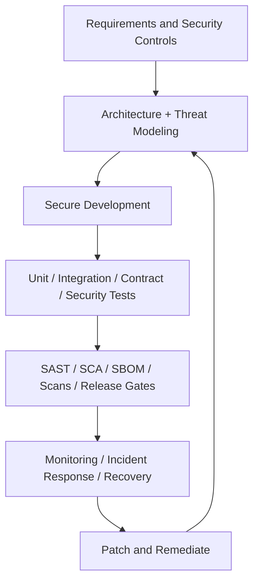

# SSDLC and Verification Handbook

> Based on the SSDLC workflow, phase gates, failure experiment catalog and definition of done in the source roadmap.

## SSDLC lifecycle

## Work products and evidence

| Stage | Work products |
|---|---|
| Requirements | Scope, functional/non-functional requirements, security controls, workload profile and acceptance criteria |
| Design | System diagrams, data flows, trust boundaries, threat model and ADRs |
| Development | Secure coding rules, reviews, least privilege, secret hygiene |
| Verification | Unit, integration, contract, negative security, failure and performance tests |
| Build / Release | Dependency scans, SAST, secret scanning, image scans, SBOM, artifact verification |
| Operations | Telemetry, SLO/alert policy, incident response and recovery drills |
| Maintenance | Patching, vulnerability remediation and architecture review |

## Failure experiment catalog

- Broker outage while publishing — Producer acknowledgements, retries and ISR behavior
- Consumer crashes before/after commit — Replay, offset commits, delivery guarantees
- Duplicated message — Idempotent consumer and deduplication
- Poison message and invalid schema — Retry topology, failure metadata and DLT replay
- Expired or untrusted client certificate — TLS and mutual client authentication
- Unauthorized Kafka principal — ACL denial, audit evidence
- Outbox publisher failure — At-least-once publication and eventual delivery
- PostgreSQL outage — Transaction boundaries and consistency
- Traffic spike / consumer slowdown — Backlog, partition constraints and lag recovery
- KRaft controller quorum loss — Metadata-plane availability
- Kubernetes broker pod restart — Stable broker identity, volume and replica recovery
- Region or cluster outage — Cross-cluster replication, restore plan and RPO/RTO

## Definition of done

- [ ] Implementation or investigation completed and committed.
- [ ] Expected behavior verified and proof recorded.
- [ ] Appropriate unit, integration, contract and negative tests executed.
- [ ] Security requirements evaluated; no new credentials committed.
- [ ] Metrics/logs and error handling inspected.
- [ ] Documentation, diagrams and any ADR updated.
- [ ] Acceptance criteria met and task status updated in CSV.

## Completion evidence for each task

Record in `Kafka_Learning_Lab_Task_Checklist.csv`: status, owner, actual effort, completion date, notes and a path/URL to the verification evidence. Keep logs, test reports and security findings under project-controlled directories as appropriate. Do not commit real credentials or private certificates.
