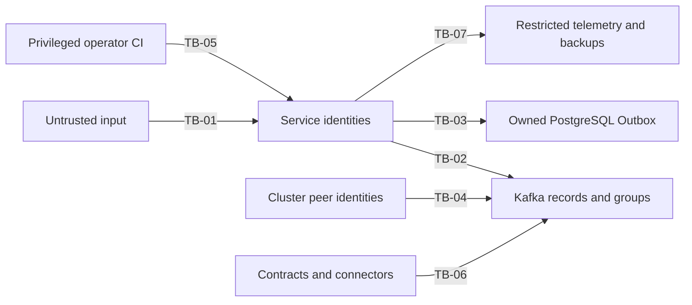

# P0-036 - Create initial STRIDE threat model

**Date:** 2026-11-24
**State:** Reviewed planning decision; no runtime implementation or measured results.

## Scope, assets and assumptions

Use the isolated synthetic system, owner-approved parallel flow and TB-01-TB-07 boundaries. Assets/owners are service-owned synthetic state and Outbox, Kafka records/offsets/metadata (lab operator), contracts/artifacts (developer/CI), credentials/keys (operator), and evidence/backups (operator/reviewer). No real customer/card data is permitted. No controls are deployed. Qualitative likelihood assumes an accidentally exposed/misconfigured lab or compromised application/tool; impact prioritizes integrity/privilege/availability even though domain data is synthetic.

## Data flows and boundaries

## STRIDE assessment

| Boundary / asset | Threat / abuse scenario | Impact | Likelihood | Mitigation / owner and phase | Planned verification | Residual state |
|---|---|---|---|---|---|---|
| TB-02/04 identities | S: impersonated producer/peer submits events or joins infrastructure | High integrity/privilege | Medium | Operator: trust/identity/credential lifecycle P9 | Invalid/untrusted/expired identity denied; intended identity allowed | Open, no runtime identity controls |
| TB-01/02/03/06 state/contracts | T: modified input, event, schema or Outbox changes effects | High integrity | Medium | Developer/operator: validation, contracts, scoped DB/ACLs P6-P9 | Malformed/incompatible/forbidden write rejected; state reconciled | Open; semantic tampering needs application review |
| TB-05/07 audit/evidence | R: privileged action or replay cannot be attributed | Medium accountability | Medium | Developer/operator: correlated sanitized audit/runbook evidence P9/P10/P14 | Known action traceable to identity/time/task without secret capture | Open; logs are not tamper-proof proof by default |
| TB-02/03/07 secrets/copies | I: plaintext listeners or logs/backups reveal sensitive material | High secret exposure | Medium | Operator: isolated exposure, TLS, access/redaction/retention P9/P10/P12 | Inspect evidence; unintended read/connection denied | Open; keys/real data prohibited now |
| TB-01/02/04 capacity | D: oversized/poison records, unlimited retries/load, quota/resource or quorum failure | High availability | Medium | Developer/operator: bounds, retry/DLT, workload limits, topology/recovery P6/P11-P13 | Bounded poison/load/quorum fault with visible recovery | Open; actual limits unselected/unverified |
| TB-03/05/06 privileges | E: app/connector/CI account acquires admin or another service's data rights | High privilege/integrity | Medium | Operator: role/ACL/RBAC separation and supply-chain gates P8/P9/P13/P14 | Forbidden cross-domain/admin action rejected; failing release gate blocks | Open; full privilege model not implemented |

## Findings and follow-ups

All six findings remain open planning risks. Secret/data hygiene and isolation apply immediately; the named developer/operator roles own future verification, not invented personal assignees. Prioritize identity/privilege/exposure and unsafe resource behavior before expanding a running environment. Record denied and allowed operations at the intended layer, remediation/retest, and remaining limitations. Reassess when a component/version, listener, trust relationship, persistence/replay policy or deployment model changes. No scanner, penetration test, negative connection test or abuse experiment ran in P0; document review and tracker checks are the actual evidence.

## Evidence

See [task learning record](../learning-notes/P0/P0-036.md) and [document review](../testing/evidence/P0-036-review.md).
