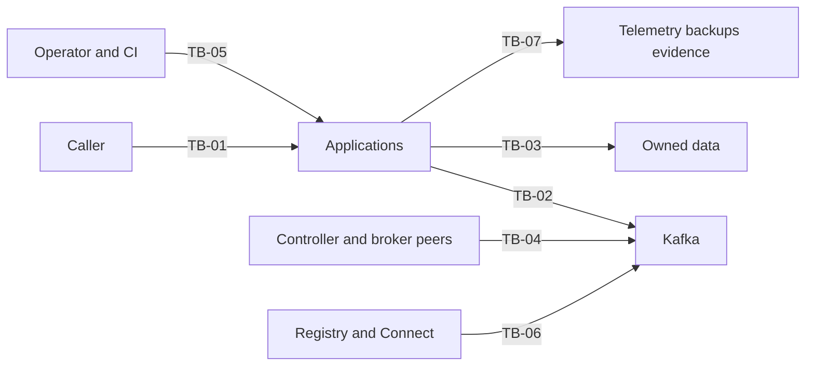

# P0-035 - Identify trust boundaries

**Date:** 2026-11-24
**State:** Reviewed planning decision; no runtime implementation or measured results.

## Boundaries and assets

| ID | Crossing / asset | Principals and trust change | Target controls and evidence |
|---|---|---|---|
| TB-01 | Learner/generator -> Order; synthetic input | Caller-supplied data becomes validated application state | Input size/type/quantity constraints, bounded concurrency, explicit errors; invalid-input tests |
| TB-02 | Application -> Kafka; events/groups | Separate producer/consumer identities access shared broker infrastructure | TLS/authentication/ACLs and contract policy; allowed/denied operations |
| TB-03 | Stateful service -> owned PostgreSQL/Outbox | Application and database privileges; publication intent integrity | Dedicated role/ownership, local transaction and protected access; cross-service denial/recovery |
| TB-04 | Broker <-> broker/controller; metadata and records | Data/control-plane identities and privileged consensus operations | Reviewed listeners/trust/roles, quorum/replication failure and negative-authentication tests |
| TB-05 | Operator/CI -> artifacts/infrastructure/secrets | Administrative and supply-chain authority exceeds application needs | Least privilege, protected secrets, review/provenance and release gates; audit/failing-gate tests |
| TB-06 | Clients/registry/Connect | Contract and capture privileges influence application data | Governed schemas and narrow connector/DB/topic permissions; incompatibility and forbidden-access tests |
| TB-07 | Services -> telemetry/backups/reviewer | Diagnostic/recovery copies may expose data or mutable evidence | Redaction, restricted access, integrity/recovery procedures, bounded retention; inspect sanitized evidence |

All boundaries are conceptual; none is enforced by this document. Assets include synthetic record/state correctness, offsets/progress, cluster metadata, schema/config integrity, administrative credentials/keys, artifacts and evidence. No secret values or real customer data are included. The learner/operator may be one human, but administrative and application authority must remain distinguishable.

P0-036 assesses threats against these crossings. Runtime identity, network, database and evidence controls remain progressive at their owning milestones; host co-location never removes a logical ownership boundary.

## Evidence

See [task learning record](../learning-notes/P0/P0-035.md) and [document review](../testing/evidence/P0-035-review.md).
